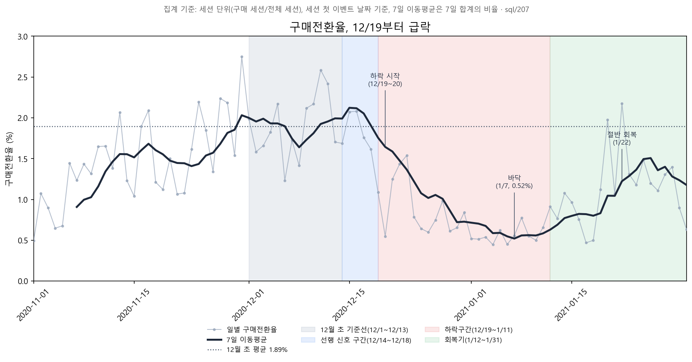

# Google Merchandise Store 연말 구매전환율 하락 분석

> 연말 구매전환율 60% 하락의 핵심은 "목록까지 와서 장바구니에 담지 않은 것"이었고, 원인은 선물 시즌 종료로 인한 구매 의도 감소로 좁혀짐. 이탈 사용자를 다시 불러오는 리마인드 실험을 설계함.

## 프로젝트 개요

| 항목 | 내용 |
|---|---|
| 데이터 | BigQuery 공개 데이터셋 `ga4_obfuscated_sample_ecommerce` (Google Merchandise Store), 2020.11~2021.01 |
| 도구 | BigQuery SQL, Python, Claude Code |
| 핵심 지표 | 구매전환율 = 구매 세션 / 전체 세션 |

## 질문과 답

| 질문 | 답 |
|---|---|
| 무엇이 문제였나 | 구매전환율이 12월 초 1.895%에서 하락구간(12/19~1/11) 0.748%로 떨어짐 (−60.5%) |
| 어디서 떨어졌나 | 하락의 약 76%가 "방문 → 장바구니 담기" 단계에서 발생함. 목록 도달은 유지됐으나 목록 이후 장바구니 담기가 하락함 |
| 왜 떨어졌나 | 가설 6개 중 부분 지지 1개, 보류 1개, 기각 4개. 남은 설명은 배송 마감과 연휴를 지나며 구매 의도가 줄었다는 것(특히 의류) |
| 무엇을 할 것인가 | 이탈 사용자 대상 리타게팅 광고 A/B 테스트를 설계함 (7일 안 재방문율 15.9% → 17.5% 목표). 과거 데이터로 실행할 수 없어 설계만 함 |

## 문서 읽는 순서

1. [docs/13 프로젝트 결과](docs/13_results.md): 전체 결과 요약
2. [docs/09 문제 재정의](docs/09_problem_redefinition.md): 구매전환율 기준 문제의 크기와 퍼널 단계 분해
3. [docs/10 원인 분석](docs/10_root_cause.md): 원인 가설 6개의 검증과 판정
4. [docs/11 해결 가설](docs/11_solution.md): 해결 가설 5개, ICE 점수, 실험 대상 선정
5. [docs/12 A/B 테스트 설계](docs/12_ab_test_design.md): 선택한 실험의 목적, 가설, 계획, 지표, 의사결정

docs/01~08은 서비스 이해, OMTM 정의, AARRR 진단과 장바구니 담기→결제 시작을 핵심으로 봤던 이전 단계 분석이며, 이후 퍼널을 다시 분해하며 문제를 재정의함

## 폴더 구조

- `sql/`: 분석에 쓴 BigQuery 쿼리 (번호순, 각 파일 상단에 목적 주석)
- `notebooks/`: 쿼리 실행기(`run_query.py`)와 차트·검정·표본 크기 계산 Python 스크립트
- `docs/`: 단계별 분석 문서와 결과 요약
- `reports/`: 분석 차트(`charts_ver2/`가 현재 기준)와 웹 아카이브 증거 캡처(`evidence/`)
- `data/`: 쿼리 결과 CSV (`sql/`과 같은 파일명)

실행하려면 `GCP_PROJECT_ID` 환경변수와 gcloud 로그인(ADC) 필요
