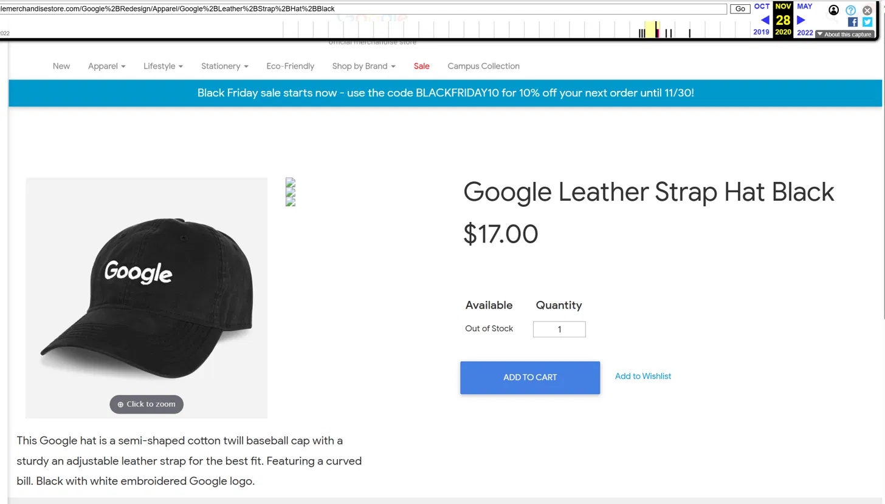
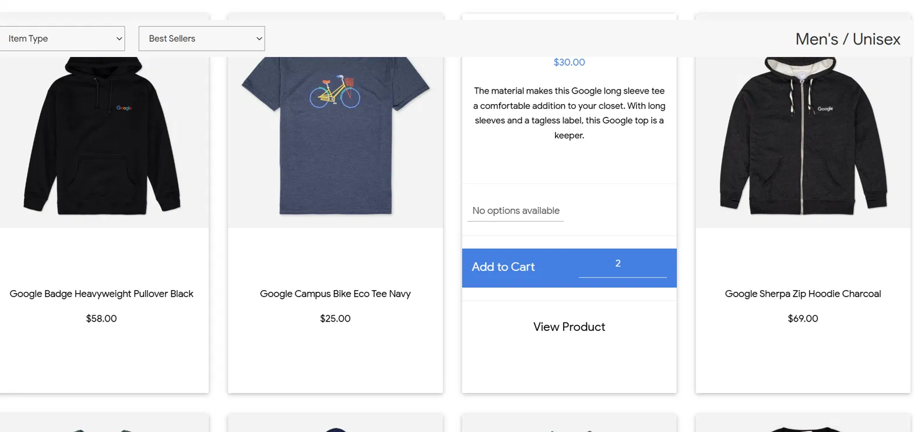
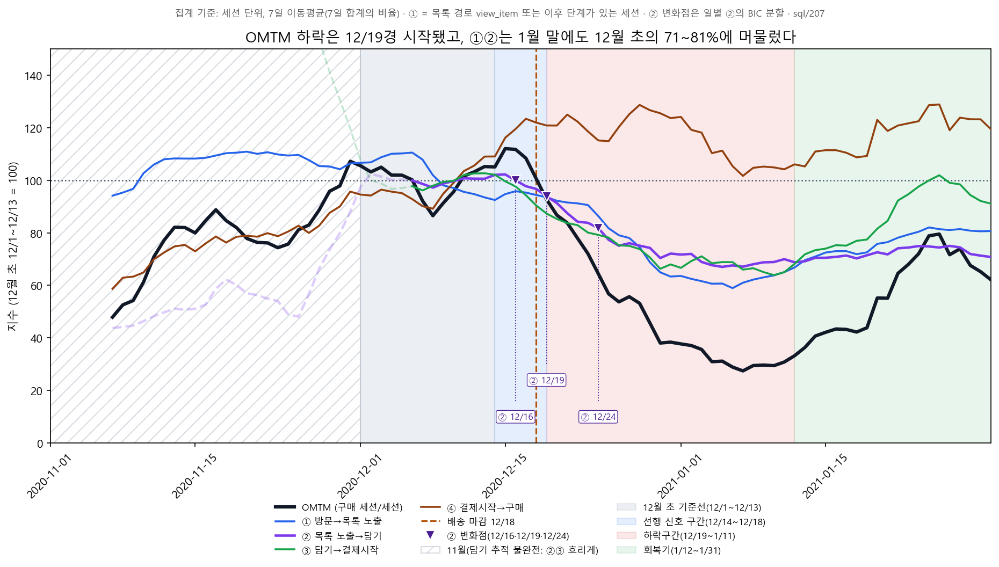

# 09. 문제 재정의 (OMTM 기준)

| 기호 | 단계 | 비고 |
|---|---|---|
| ① | 방문→목록 노출 / 목록 도달 | 기록 방식에 따라 view_item 기준과 page_view 기준이 다름. view_item 기준은 '목록 노출', page_view 기준은 '목록 도달'로 표기. 각 절에 어떤 기준인지 표시 |
| ② | 목록 도달→장바구니 담기 | |
| ③ | 장바구니 담기→결제 시작 | |
| ④ | 결제 시작→구매 | |

> 2020-12-19 ~ 2021-01-11 사이 OMTM(구매전환율 = 구매 세션 / 전체 세션)이 12월 초(12/1~12/13) 1.895%에서 0.748%로 떨어졌다(−60.5%). 하락의 약 76%는 방문→담기(방문→목록 노출 + 목록 노출→담기)에서 나왔고, 담기→결제시작이 37%, 결제시작→구매는 −13%(오히려 개선)다. 회복기(1/12~1/31)에는 담기→결제시작이 지수 90으로 돌아왔지만 방문→담기는 지수 57에 머물러 있다.

이 문서는 사실만 적는다. 원인에 대한 해석과 가설은 `docs/10_root_cause.md`에서 다룬다.

---

## 1. 분석 기간과 데이터 품질

### 기간 구분

| 구간 | 기간 | 용도 |
|---|---|---|
| 기준선 | 12/1~12/13 | 비교 기준 |
| 전환 구간(선행 신호 구간) | 12/14~12/18 | 비교에서 제외 (아래 "선행 신호" 참고) |
| 하락구간 | 12/19~1/11 | OMTM 하락 시작일 기준 |
| 회복기 | 1/12~1/31 | 하락 이후 회복 여부 확인 |

11월은 담기·결제시작 기록이 불완전해서 단계별 비교에서 제외했다. 근거(11/1~11/22 begin_checkout 이벤트의 상품 0개, 구매자 중 담기 기록 보유율 11월 초 0~35%)는 `docs/07_hypothesis1_verification.md`의 "데이터 품질 점검" 섹션에 있다. 담기가 들어가는 단계(② 목록 노출→담기, ③ 담기→결제시작)의 11월 구간은 차트에서 흐리게 표시했다. OMTM(구매 세션 / 전체 세션)은 담기 기록을 쓰지 않아서 일별 추이와 전체 평균(11/1~1/31)에는 11월을 포함했다.

블랙프라이데이 10% 할인 코드(BLACKFRIDAY10)는 11/30까지였다(웹 아카이브 11/28 캡처의 상단 배너).

웹 아카이브 캡처일 기준이며, 게시 시작 시점은 알 수 없음

### 퍼널 정의

※ 기준: 이 문서의 ①②는 별도 표시가 없으면 view_item 기준(목록 경로)

**방문 → 목록 노출 → 담기(add_to_cart) → 결제시작(begin_checkout) → 구매(purchase)**

- **방문**은 특정 페이지가 아니라 한 번의 세션이다. 세션 키는 `user_pseudo_id + ga_session_id`이고 `ga_session_id`가 없는 이벤트는 제외한다(`docs/02`, `sql/01`과 같은 규칙). 세션 날짜는 세션의 첫 이벤트 날짜다.
- **view_item은 목록 노출과 상품 상세 조회가 섞여 있다**(12/1~1/11, `sql/206`).
  - **목록 경로**에서 찍힌 view_item은 116,618건이고 모두 아이템이 들어 있다(6개 이상이 96%). 목록 경로는 add_to_cart가 10건 이상 찍힌 경로(카테고리 목록, `/store.html`, `/asearch.html` 포함 32개)다.
  - **그 외 경로**에서 찍힌 view_item은 57,995건(view_item의 33%)이고 99.6%(57,753건)가 아이템 0개다. 상품명 URL(상품 상세 페이지)에서 찍힌 상세 조회다.
- 그래서 **분석에서는 목록 경로만 ①에 썼다.** ① 방문→목록 노출의 분자는 "목록 경로에서 view_item이 있거나 이후 단계(add_to_cart, begin_checkout, purchase) 이벤트가 있는 세션"이다. 상세 경로의 view_item만 있고 이후 단계가 없는 세션은 분자에 넣지 않고 전체 세션(방문)에만 포함한다.
- 이 사이트는 목록에서 상품 사진을 누르면 카드가 뒤집히며 "add to cart"와 "view product" 버튼이 나오는 구조라(당시 사이트 스냅샷에서 확인한 UI), 상세 페이지를 거치지 않고 담을 수 있다. 데이터로는 add_to_cart 이벤트 40,166건 중 40,152건(99.97%)이 목록 경로에서 찍혔다. add_to_cart 세션 9,762개 중 9,755개(99.9%)는 같은 세션에서 view_item도 발생했다.

웹 아카이브 캡처일 기준이며, 게시 시작 시점은 알 수 없음 (캡처일 미확인)

- **상세 페이지를 거친 세션**(상품명 URL의 page_view가 있는 세션, `sql/201`): 41,157개 중 5,647개(13.7%)가 담았고, 거치지 않은 세션은 121,646개 중 4,115개(3.4%)가 담았다. 담기 세션(9,762개)의 **58%**가 상세 페이지를 거쳤다. 그런데 상세 페이지를 본 뒤에 담은 3,824세션 중 3,816세션은 목록 경로에서 담았고, **상세 경로에서 찍힌 담기는 세션 11개**뿐이다.
- 나머지 단계는 **"그 단계 또는 이후 단계 이벤트가 있는 세션"**으로 센다. ② 담기 도달 세션은 add_to_cart, begin_checkout, purchase 중 하나라도 있는 세션이고, ③ 결제시작 도달 세션은 begin_checkout 또는 purchase가 있는 세션이다. 장바구니가 세션을 넘어 유지되어서 한 세션 안에 담기 없이 결제시작·구매만 있는 경우가 있고(구매 세션의 약 25%), 이벤트 유무로만 세면 단계 비율이 100%를 넘는 왜곡이 생긴다(`docs/04` 참고). 이 정의에서는 모든 단계 비율이 100% 이하이고, ①×②×③×④가 OMTM과 정확히 일치한다.
- 일별 값은 세션 날짜 기준이고, 7일 이동평균은 일별 비율의 평균이 아니라 7일 합계의 비율이다.

(쿼리: `sql/207_daily_session_funnel_list_exposure.sql`. 초판 정의(상세 경로 포함 모든 view_item을 ①로 셈)는 `sql/191`이며, 3절 말미에 이전 수치를 적었다.)

---

## 2. OMTM 하락구간

차트: `reports/charts_ver2/problem_omtm_daily.png`

| 구간 | 세션 | 구매 세션 | OMTM | 12월 초 대비 | 전체 평균(1.346%) 대비 |
|---|---|---|---|---|---|
| 기준선 12/1~12/13 | 65,234 | 1,236 | **1.895%** | 100% | 141% |
| 전환 12/14~12/18 | 26,536 | 492 | 1.854% | 98% | 138% |
| **하락 12/19~1/11** | 82,384 | 616 | **0.748%** | **39% (−60.5%)** | 56% |
| 회복기 1/12~1/31 | 77,574 | 886 | 1.142% | 60% (−39.7%) | 85% |
| 전체 11/1~1/31 | 360,129 | 4,848 | 1.346% | 71% | 100% |

- 기준선은 전체 평균(1.346%)보다 41% 높다. 전체 평균에는 하락구간 자체가 포함되어 있다.
- 하락 시작: 일별 OMTM이 12/19에 1.09%, 12/20에 0.55%로 꺾였다. 7일 이동평균 지수(12월 초 = 100)가 90 미만으로 내려가 7일 이상 유지된 첫 날은 **12/20**이다.
- 최저점: **1/7**(7일 이동평균 0.52%, 지수 27).
- 회복: 1/12부터 오르기 시작했고, 최저점과 100의 중간까지 회복한 날(절반 회복)은 **1/22**이다. 1/31 지수는 62다.

### 선행 신호 구간 (12/14~12/18)

※ 기준: ①② view_item 기준(목록 경로)

이 5일 동안 OMTM은 1.854%(지수 98)로 기준선과 같은 수준이었다. 단계별로는 ③ 담기→결제시작이 43.41%(지수 86)로 이미 14% 낮았고, ④ 결제시작→구매가 56.36%(지수 126)로 26% 올라서 OMTM에는 드러나지 않았다. ①은 지수 95, ②는 95였다. 이 구간은 OMTM 비교(기준선 vs 하락구간)에서 제외하고 별도 구간으로 두었다.

---

## 3. 퍼널 단계 분해와 기여도

### 구간별 단계 비율

표의 괄호는 12월 초를 100으로 둔 지수다. ①은 위 정의대로 목록 경로 기준이다.

| 지표 | 기준선 | 전환 | 하락 | 회복기 | 전체 |
|---|---|---|---|---|---|
| OMTM | 1.895% | 1.854% (98) | 0.748% (39) | 1.142% (60) | 1.346% (71) |
| ① 방문→목록 노출 | 18.72% | 17.84% (95) | 12.87% (69) | 14.66% (78) | 16.70% (89) |
| ② 목록 노출→담기 | 44.82% | 42.48% (95) | 32.24% (72) | 32.43% (72) | 33.81% (75) |
| **① + ② 방문→담기** (담기 도달 세션/전체 세션) | **8.39%** | 7.58% (90) | **4.15% (49)** | **4.75% (57)** | 5.65% (67) |
| ③ 담기→결제시작 | 50.46% | 43.41% (86) | 35.68% (71) | 45.20% (90) | 54.63% (108) |
| ④ 결제시작→구매 | 44.77% | 56.36% (126) | 50.49% (113) | 53.15% (119) | 43.64% (97) |

목록 노출 도달 세션(①의 분자)은 기준선 12,209, 전환 4,734, 하락 10,605, 회복기 11,373, 전체 60,148이다.

차트: `reports/charts_ver2/problem_stage_index.png`

### 하락 기여도

※ 기준: ①② view_item 기준(목록 경로)

각 단계 비율 변화의 로그를 OMTM 전체 변화의 로그로 나눈 값이며, 합이 100%다(곱셈 구조에 정확히 맞는다). 괄호는 일 단위 부트스트랩(3,000회) 95% 신뢰구간이다.

| 비교 | OMTM 변화 | ① 방문→목록 노출 | ② 목록 노출→담기 | **① + ② 방문→담기** | ③ 담기→결제시작 | ④ 결제시작→구매 |
|---|---|---|---|---|---|---|
| 기준선 → 하락(12/19~1/11) | −60.5% | 40% [33, 49] | 35% [31, 42] | **76%** [66, 88] | 37% [31, 45] | −13% [−30, −1] |
| 기준선 → 하락(12/14~1/11, 기존 시작일) | −46.3% | 46% [34, 64] | 38% [31, 50] | **84%** [69, 109] | 43% [35, 59] | −27% [−65, −8] |
| 기준선 → 회복기 | −39.7% | 48% [34, 74] | 64% [48, 95] | **112%** [86, 170] | 22% [10, 32] | −34% [−89, −8] |

- 하락구간에서 ①, ②, ③을 따로 보면 35~40%로 비슷하고 신뢰구간이 겹친다(부트스트랩 1위 비율은 ① 67%, ③ 28%, ② 5%). 순위는 시작일(12/19, 12/14)과 무관하게 ① > ③ > ②로 같았다.
- **① + ② 방문→담기는 76%로 ③(37%)의 두 배다.** 부트스트랩 3,000회 모두에서 ③보다 컸다. 12/14 시작 기준으로는 84%다.
- **방문→담기(담기 도달 세션 / 전체 세션)는 ① 방문→목록 노출의 정의에 영향을 받지 않는다.** ①을 상세 조회까지 포함해서 세도(초판) 목록 경로만으로 세도(정정판) ① + ②는 같은 값(76%)이고, 둘의 순위만 바뀐다(초판 ① 34% / ② 41%, 정정판 ① 40% / ② 35%).
- 회복기의 OMTM 잔여 격차는 방문→담기가 112%[86, 170]로 사실상 전부를 차지한다. ③은 22%이고, ④는 −34%로 격차를 줄이는 쪽이다. 개별로는 ② 64%, ① 48%다(①②③ 중 ②가 1위인 비율 99%).

### 단계별 하락 시작·바닥·회복

※ 기준: ①② view_item 기준(목록 경로)

기준: 12/14 이후 7일 이동평균 지수가 90 미만으로 내려가 7일 이상 유지된 첫 날을 하락 시작으로, 바닥 지수와 100의 중간에 도달한 날을 절반 회복으로 뒀다.

| 지표 | 하락 시작 | 바닥일 (지수) | 절반 회복 | 1/31 지수 |
|---|---|---|---|---|
| OMTM | 12/20 | 1/7 (27) | 1/22 | 62 |
| ① 방문→목록 노출 | 12/24 | 1/6 (59) | 1/24 | 81 |
| ② 목록 노출→담기 | 12/21 | 1/5 (67) | **미도달** | **71** |
| **① + ② 방문→담기** | 12/19 | 1/6 (40) | **미도달** | **57** |
| ③ 담기→결제시작 | 12/19 | 1/10 (64) | 1/21 | 91 |
| ④ 결제시작→구매 | 하락 없음 | — | — | 119 |

하락 시작일은 ③ 12/19, OMTM 12/20, ② 12/21, ① 12/24로 5일 안에 몰려 있다.

### 정정 이력 (퍼널 정의 변경 전후)

※ 기준: 초판(모든 view_item)과 현재(목록 경로 view_item)를 비교

초판은 상세 경로의 view_item까지 모두 ①로 세었다(`sql/191`). 그 정의에서는 ①②의 기준선 → 하락 값이 ① 22.85% → 16.59%, ② 36.72% → 25.01%였고, 하락 기여도는 ① 34%, ② 41%, ③ 37%였다. 상세 조회 세션이 ② 분모에 섞여 ①과 ②의 몫이 뒤섞인 결과였다. 위 표는 목록 경로 기준으로 다시 계산한 값이다.

---

## 4. 핵심 문제 구간

※ 기준: ①② view_item 기준(목록 경로). page_view 기준 비교는 아래 기록 방식 점검

**① + ② 방문→담기(담기 도달 세션 / 전체 세션)를 핵심 문제 단계로 정한다.** 근거는 다음과 같다.

1. **하락의 약 76%가 방문→담기에서 나왔다.** 하락구간(12/19~1/11) 기여도는 방문→담기 76%[66, 88], 담기→결제시작 37%[31, 45], 결제시작→구매 −13%[−30, −1]이다. 방문→담기가 담기→결제시작보다 큰 비율은 부트스트랩 3,000회 중 100%이고, 12/14 시작 기준으로도 84%[69, 109]다.
2. **회복기에 방문→담기만 회복되지 않았다.** 회복기 지수(12월 초 = 100)는 방문→담기 57(1/31 지수 57), 담기→결제시작 90(1/31 지수 91), 결제시작→구매 119다. 잔여 OMTM 격차(−39.7%)에서 방문→담기의 기여는 112%[86, 170]다.
3. **담기→결제시작은 하락구간에 같이 떨어졌지만(지수 71) 회복기에 돌아왔다(90).** 결제시작→구매 상승은 품절 모자 세션의 영향으로, 이를 제외하면 오히려 하락했다(docs/10 참고).
4. **①과 ②의 개별 순위는 정의에 따라 바뀌지만 합친 값은 바뀌지 않는다.** 방문→담기는 ① 방문→목록 노출의 정의와 무관한 값이다(초판 ① 34% + ② 41% = 정정판 ① 40% + ② 35% = 76%).

### 추가 확인: Dino Game Tee 상세 페이지 유입이 ①을 낮췄는가

※ 기준: ①② view_item 기준(목록 경로), 단 Dino Game Tee·상세 랜딩 세션의 식별과 페이지 방문 비교는 page_view 기준

초판 정의에서 1월 말(1/21~1/31)에 상세 경로 view_item 세션이 늘었고 그 1위가 Google Dino Game Tee 상품 페이지(1,926세션)였다. 이것이 ①을 낮췄는지 확인했다. (`sql/209`, `sql/210`)

- **페이지 방문은 늘지 않았다.** Dino Game Tee 페이지의 주별 page_view 세션은 12/7 주 3,499, 12/14 주 3,588에서 1/18 주 1,917, 1/25 주 1,309로 오히려 줄었다. 이 페이지를 랜딩으로 시작한 세션도 일평균 기준선 338, 하락구간 244, 회복기 236, 1/21~1/31 197이다.
- **늘어난 것은 그 페이지의 view_item 기록이다.** 그 페이지에서 view_item이 찍힌 세션이 12/7~1/11에는 주 5~35개였는데 1/18 주 895, 1/25 주 1,107로 늘었다. 이 페이지의 담기 세션은 모든 주에서 0이다.
- **이 세션들을 빼도 ①과 방문→담기의 회복기 수준은 달라지지 않는다.** 같은 세션을 기준선·하락구간·회복기에서 모두 뺀 결과다.

| 제외 대상 | ① 기준선 → 회복기 (지수) | ① + ② 기준선 → 회복기 (지수) |
|---|---|---|
| 제외 없음 | 18.72% → 14.66% (78) | 8.39% → 4.75% (57) |
| 상세 페이지 랜딩 세션 제외 | 20.30% → 15.89% (78) | 9.08% → 5.13% (57) |
| Dino Game Tee 랜딩 세션 제외 | 20.04% → 15.55% (78) | 8.98% → 5.05% (56) |
| Dino Game Tee를 본 세션 제외 | 19.84% → 15.41% (78) | 8.88% → 4.99% (56) |
| 상세 랜딩 + Dino를 본 세션 제외 | 20.10% → 15.75% (78) | 8.96% → 5.07% (57) |

1/21~1/31만 보면 ① 지수가 제외 없음 81, 제외 시 80이다. 즉 Dino Game Tee 상세 페이지 유입은 ①을 낮춘 요인이 아니다. 초판 정의에서 1월 말 ②가 한 번 더 떨어져 보였던 것은 이 페이지에서 view_item이 기록되기 시작해 상세 경로 세션이 ② 분모에 들어간 효과였고(② 1.2% → 1.0% 수준, 목록 경로 노출 세션의 ②는 30.9% → 31.7%로 그대로), 새 정의에서는 이런 세션이 ①에 들어가지 않는다. (`sql/204`, `sql/205`)

### 기록 방식 점검(H4b): 방문→담기 하락은 기록 변화로 설명되지 않는다

view_item과 add_to_cart의 기록 방식이 시기별로 바뀌었을 가능성(Dino Game Tee view_item 기록, add_to_cart의 quantity>0 비율 변화)을 확인하려고 ①과 ②를 다른 기록으로 다시 계산했다. 상세 검증은 `docs/10_root_cause.md`에 있다. (`sql/211`~`213`)

| 정의 | 기준선 | 하락 (지수) | 회복기 (지수) |
|---|---|---|---|
| ① view_item 기준 (기존) | 18.72% | 12.87% (69) | 14.66% (78) |
| **① page_view 기준** (목록 경로 page_view 또는 이후 단계가 있는 세션 / 전체 세션) | 53.24% | 56.51% (**106**) | 53.74% (**101**) |
| ② view_item 기준 (기존) | 44.81% | 32.24% (72) | 32.43% (72) |
| **② page_view 기준** | 15.75% | 7.34% (**47**) | 8.85% (**56**) |
| ① + ② 방문→담기 | 8.39% | 4.15% (49) | 4.75% (57) |
| ① + ② (quantity>0 담기, 이후 단계 포함) | 7.92% | 3.48% (44) | 4.12% (52) |
| ① + ② (quantity>0 담기만) | 6.87% | 2.86% (42) | 3.26% (47) |

- **page_view 기준으로는 목록 도달(①)이 줄지 않았다**(지수 106, 101). 하락은 목록에 도달한 뒤 담기(②)에서 발생했다(지수 47, 56). page_view는 목록 페이지 도달 자체를 세므로 view_item 기록 변화(12/29, 1/19)의 영향을 받지 않는다.
- 방문→담기(① + ②)는 어떤 기록으로 세도 같은 하락이 나온다(하락 지수 42~49, 회복기 47~57). quantity>0 담기만 세면 오히려 더 깊게 나오는데, quantity>0 비율이 12/8 83% → 12/9 57%로 떨어져 담기를 과소 집계하기 때문이다.
- 그래서 **핵심 문제 단계는 ① + ② 방문→담기로 유지하되, 기록 방식에 가장 덜 민감한 page_view 기준으로 보면 하락의 위치는 ②(목록 도달 이후 담기)다.**

### 방문→담기 안에서 ②(목록 노출→담기)에 대해 확인한 것

※ 기준: ② view_item 기준(목록 경로), 단 랜딩 페이지 유형은 세션 첫 page_view 경로 기준

방문→담기 안에서 ②를 세부 지표로 확인했다.

- **목록 경로 ②는 12/24 이후 기준선보다 낮은 수준에서 평평하게 유지되며 회복되지 않았다.** 일별 ②의 변화점은 BIC 기준 3개(12/16, 12/19, 12/24)이고, 구간별 값은 12/1~12/15 44.9%, 12/16~12/18 40.5%, 12/19~12/23 35.5%, **12/24~1/31 31.8%**다(기준선 44.8%의 71%). 12/24 이후에는 변화점이 없다.
- **② 하락은 데이터 문제가 아니다.** (쿼리: `sql/193`, `sql/158`, `sql/208`)

| 확인 | 결과 |
|---|---|
| add_to_cart 이벤트 중 상품 정보(items)가 있는 비율 | 11/16 주 이후 매주 **100%** |
| 구매자 중 담기 기록 보유율 | 1/4 주 77.2%, 1/11 주 80.0%, 1/18 주 83.9%, 1/25 주 81.1% (기준선 주: 11/30 주 85.7%, 12/7 주 82.2%) |

주별 ②(목록 노출→담기, 월요일 시작 주. 11/30 주는 12/1~12/6만 포함)

| 주 | 11/30 | 12/7 | 12/14 | 12/21 | 12/28 | 1/4 | 1/11 | 1/18 | 1/25 |
|---|---|---|---|---|---|---|---|---|---|
| ② | 44.48% | 45.07% | 40.92% | 34.08% | 30.89% | 30.87% | 31.98% | 33.59% | 31.73% |

- **세션 구성 변화로는 거의 설명되지 않는다.** 기준선(12/1~12/13) 44.8%에서 1/18~1/31 32.7%로 내려간 −12.1%p를 구성 변화와 그룹 내 비율 변화로 나눴다.

| 구분 기준 | 구성 변화 기여 | 그룹 내 비율 변화 기여 |
|---|---|---|
| 신규/재방문 | −0.01%p | −12.12%p |
| 랜딩 페이지 유형 | −0.55%p | −11.58%p |
| 채널 | +0.01%p | −12.14%p |
| 기기 | 0.00%p | −12.13%p |

  - 목록 노출 세션 중 신규 세션 비중은 기준선 주와 1월 말 주가 같다(63.1%).
  - 신규 세션의 ②는 41.5%에서 27.0%로, 재방문 세션은 50.5%에서 42.5%로 떨어졌다.
  - 랜딩이 홈인 세션의 ②는 51.3%에서 35.3%로, 랜딩이 카테고리 목록인 세션은 31.8%에서 25.4%로 떨어졌다.

**결론**: 하락구간 기여의 약 76%가 방문→담기에서 나왔고, 회복기에도 방문→담기만 지수 57에 머물러 있다(담기→결제시작은 하락 때 같이 떨어졌지만 회복기에 90으로 돌아왔고, 결제시작→구매 상승은 품절 모자 세션의 영향으로, 이를 제외하면 오히려 하락했다 — docs/10 참고). 방문→담기 값은 ①의 정의와 무관하게 안정적이고, 1월 말 Dino Game Tee 상세 페이지의 영향도 확인되지 않았다. 이 근거로 **① + ② 방문→담기를 핵심 문제 단계로 정한다.** 그 안에서 ②의 원인 분석은 카테고리 목록 페이지 단위로 진행하고, 담기는 "같은 카테고리 페이지에서의 담기"를 메인으로 본다.

---

## 5. 임팩트

※ 기준: ①② view_item 기준(목록 경로)

기준선 OMTM(1.895%)이 하락구간(12/19~1/11, 82,384 세션)에서도 유지됐다면 얼마나 더 구매 세션이 나왔는지로 추정했다. (쿼리: `sql/207`, `sql/192`)

**대표 수치 — 놓친 구매 세션**

| 항목 | 값 |
|---|---|
| 반사실 구매 세션 (82,384 × 1.895%) | 1,561 |
| 실제 구매 세션 | 616 |
| **놓친 구매 세션** | **약 945 (95% CI 846~1,044)** |

신뢰구간은 OMTM 차이 1.147%p의 95% CI [1.027, 1.267]%p를 하락구간 세션 수에 곱한 값이다.

**보조 수치 — 매출 환산**

- 하락구간 구매 세션당 매출(중복 제거, 금액이 기록된 595 세션 기준) $66.67 → 손실 매출 **약 $63k** (95% CI $56,407 ~ $69,592)
- 기준선 구매 세션당 매출($76.11)을 적용하면 약 $71.9k

**단계별 몫** (새 ① 정의 기준)

| 단계 | 로그 기여도 분배 (세션 / 매출) | 해당 단계만 12월 초 수준으로 되돌렸을 때 회복 (세션 / 매출) |
|---|---|---|
| ① 방문→목록 노출 | 380 / $25.4k (40%) | 280 / $18.6k |
| ② 목록 노출→담기 | 335 / $22.3k (35%) | 240 / $16.0k |
| **① + ② 방문→담기** | **715 / $47.7k (76%)** | **629 / $41.9k** |
| ③ 담기→결제시작 | 352 / $23.5k (37%) | 255 / $17.0k |
| ④ 결제시작→구매 | −122 / −$8.2k (−13%) | −70 / −$4.7k |

두 방식의 차이는 단계들이 함께 움직인 상호작용분이다.

**한계**
- 비용 데이터가 없어 이익이 아니라 **매출 규모** 추정이다.
- 기준선(12월 초)이 연말 성수기라 높게 잡혀 있어서, 추정치에 **계절적 감소가 포함**되어 있다(기준선은 전체 평균의 141%).
- 하락구간의 실제 세션 수(일평균 3,433)를 고정하고 전환율만 기준선으로 되돌린 추정이라 **트래픽 감소 효과는 포함되지 않았다**(기준선 일평균 5,018 세션).
- 세션당 매출은 하락구간 단일 값이다. 구매 이벤트 날짜 기준 하락구간 구매 세션 618개 중 23개는 금액이 기록되지 않았다(위 616개는 세션 첫 이벤트 날짜 기준이라 2개 차이가 난다).

---

## 6. 기존 분석(담기→결제시작)과의 관계

※ 기준: ①② view_item 기준(목록 경로)

- 기존 `docs/04`, `docs/07`은 담기→결제시작의 사용자 코호트 추이(12/14 주부터 하락)로 하락구간을 정해 시작일이 12/14였다. 이번에는 OMTM 자체(세션 단위)의 일별 추이로 정해서 시작일이 12/19다.
- 처음엔 단계별 %p 하락폭으로 비교해(담기→결제시작 −13~15%p, 방문→담기 −3%p) 담기→결제시작을 문제 단계로 골랐다. 하지만 구매전환율은 단계별 곱이라, 비율 기준으로 다시 분해했다. 비율 기준으로는 방문→담기(×0.49)가 담기→결제시작(×0.71)보다 훨씬 크게 떨어졌고, 방문→담기 안에서는 ① 방문→목록 노출(×0.69)과 ② 목록 노출→담기(×0.72)가 비슷하게 떨어졌다.
- 단위가 다르다. `docs/04`의 담기→결제시작은 첫 담기 사용자 코호트(50.59% → 35.92%, 기준선 vs 12/14~1/11)이고, 이 문서의 ③은 세션 단위(50.46% → 35.68%, 기준선 vs 12/19~1/11)다.
- `docs/04`의 임팩트($9,718, 손실 구매자 121명)는 담기 이후 구간(cart→purchase)의 사용자 코호트 추정이다. 이 문서의 임팩트(놓친 구매 세션 약 945, 약 $63k)는 OMTM 전체 기준이라 대상 범위가 다르다.
- `docs/07`의 원인 가설 검증(상품 구성, 구매 유예, 국가)은 담기→결제시작 단계에 대한 것이고, 이 문서의 ②에 대한 검증은 아니다.

---

## 7. 한계

※ 기준: ①② view_item 기준(목록 경로), 단 기록 방식 비교 항목의 ① 지수 106/101, ② 47/56은 page_view 기준

- **한 시즌 데이터(11/1~1/31)**라서 정상적인 계절 하락과 이상 하락을 구분할 수 없다.
- **단계별 하락 시작이 5일 안에 몰려 있어**(12/19~12/24) 단계 간 선후 관계는 약한 단서다. 7일 이동평균과 임계값(지수 90)에 따라 순서가 달라질 수 있고, 7일 후행 이동평균은 실제 변화보다 늦게 나타난다.
- **① 방문→목록 노출과 ② 목록 노출→담기의 개별 순위는 안정적이지 않다.** 하락구간에서 ①②는 35~40%로 비슷하고 신뢰구간이 겹치며, 퍼널 정의(목록 경로 기준 ①)에 따라 달라졌다(초판 ① 34%, ② 41% → 정정 후 ① 40%, ② 35%). 둘을 합친 방문→담기(76%)는 정의와 무관하다.
- **목록 경로 구분 때문에 ①②의 분리가 흔들릴 수 있다.** 1월 말 Dino Game Tee 상세 페이지에서는 view_item 기록이 새로 생겼다(페이지 방문은 늘지 않음). view_item 이벤트의 기록 방식은 시기별로 일정하지 않을 수 있어서, 방문→목록 노출과 목록 노출→담기를 따로 해석하는 데 한계가 있다.
- **① 방문→목록 노출과 ② 목록 노출→담기의 분리는 기록 방식에 따라 크게 달라진다.** view_item 기준으로는 ① 지수 69/78, ② 72/72이지만 page_view 기준으로는 ① 106/101, ② 47/56이다. 그래서 핵심 문제 단계를 ①+②(방문→담기)로 묶었다. 하락 기여도 표의 ①과 ② 값도 view_item 기록에 의존한다.
- **목록 경로 구분은 경험적 분류다.** add_to_cart가 12/1~1/11에 10건 이상 찍힌 경로(store.html, asearch.html 포함 32개)를 목록 경로로 봤고, 상세 페이지는 그 밖의 상품명 URL로 봤다.
- **상품 단위 분석은 담기 기록 특성상 어렵고, 카테고리 단위로만 가능하다.**
  - add_to_cart 이벤트의 items에는 평균 11.9개 상품이 들어 있다(11개 이상 93.6%, 1개 2.6%).
  - 실제 담은 상품 후보인 quantity>0 아이템은 이벤트의 61%에만 있고(이벤트당 최대 1개), 그 비율이 11/16 주 99% → 12/7 주 64% → 12/14 주 52% → 12/21 주 48% → 1월 말 51~57%로 시간에 따라 변해서 기간 간 비교에 편향이 생긴다.
  - `item_list_name`은 쓸 수 없는 값("(not set)" 또는 "Not available in demo dataset")뿐이다.
  - 카테고리 단위는 `page_location` 경로로 가능하다. 카테고리 목록 페이지의 view_item 아이템은 그 페이지 카테고리와 일치했다(Hats 100%, Men's 96.4%, Clearance는 Sale 93.4%, Notebooks 97.4%이고, 나머지는 같은 카테고리의 다른 표기였다).
- **상세 페이지 경로에서 찍힌 담기는 거의 없어(세션 11개), 상세에서 담아도 기록이 안 되는지, 목록으로 돌아가 담는지 구분할 수 없다.** 카테고리 목록 단위 분석에서 제외되는 양은 거의 없다. (`sql/201`)
- 이 분석은 관찰 데이터이고, 5절의 임팩트는 방향성 있는 규모 추정이다.

---

## 데이터 출처

| 쿼리 | 내용 |
|---|---|
| `sql/207_daily_session_funnel_list_exposure.sql` | 일별 누적 세션 퍼널 (OMTM, ①~④, ① = 목록 경로 기준) |
| `sql/191_daily_session_funnel_cumulative.sql` | 초판 정의의 일별 퍼널(모든 view_item을 ①로 셈, 정정 이력 비교용) |
| `sql/192_revenue_per_purchase_session_windows.sql` | 구간별 구매 세션당 매출 |
| `sql/193_weekly_add_to_cart_items_presence.sql` | 주별 add_to_cart 이벤트의 상품 정보 비율 |
| `sql/208_list_exposed_sessions_composition_v2.sql` | 목록 노출 세션의 구성(신규, 채널, 기기, 랜딩), 새 정의 |
| `sql/204`, `sql/205` | ② 분모 구성(목록 경로 vs 상세 경로)과 1월 말 상세 경로 view_item 경로 |
| `sql/201`, `sql/206` | 상세 페이지 세션의 담기 양상, view_item·add_to_cart의 경로별·아이템 수별 분포 |
| `sql/209`, `sql/210` | 상세 랜딩·Dino Game Tee 세션을 뺐을 때의 ①, ①+②, Dino Game Tee 페이지의 주별 page_view vs view_item 세션 |
| `sql/211`~`213` | 기록 방식 점검: ① page_view 기준, ② quantity>0 기준, 일별 이벤트 수 비율, 구매 세션의 앞 단계 기록 보유율 |
| `sql/186`~`190`, `sql/195`~`200` | view_item·add_to_cart 발생 페이지, items 구조 확인 |

---

## 증거 자료

`reports/evidence/`의 웹 아카이브(Wayback Machine) 캡처다. 모두 캡처일 기준이며 게시 시작 시점은 알 수 없다. (H2 관련 캡처는 `docs/10_root_cause.md`의 증거 자료 참고)

| 파일명 | 캡처일 | 증명하는 내용 |
|---|---|---|
| `2020-11-28_leather-strap-hat-black_out-of-stock.png` | 2020-11-28 | 블랙프라이데이 배너("...BLACKFRIDAY10 for 10% off your next order until 11/30!") |
| `list-card-add-to-cart_mens.png` | 캡처일 미확인 | 목록 카드에서 상품을 누르면 "Add to Cart"와 "View Product" 버튼이 나옴(상세 페이지 없이 담기 가능) |
