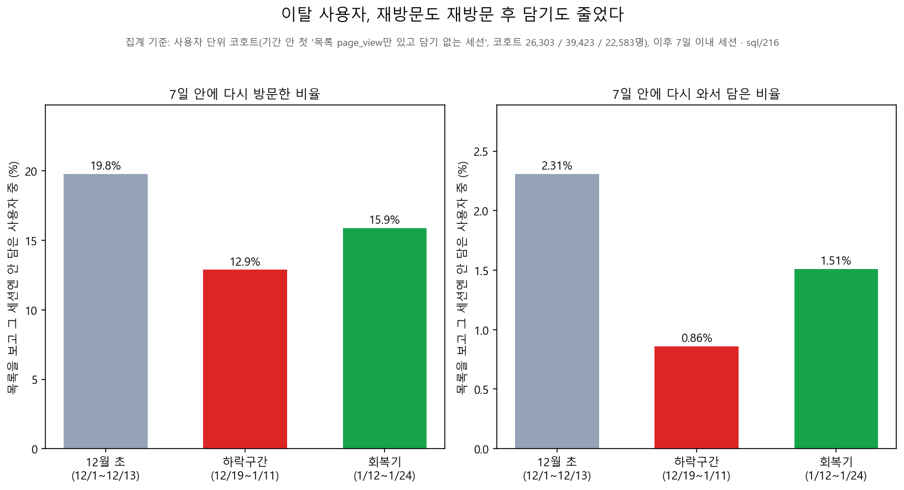
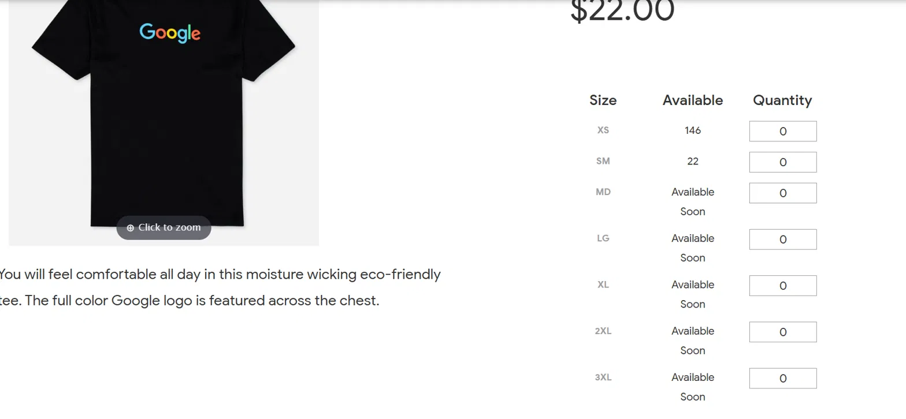
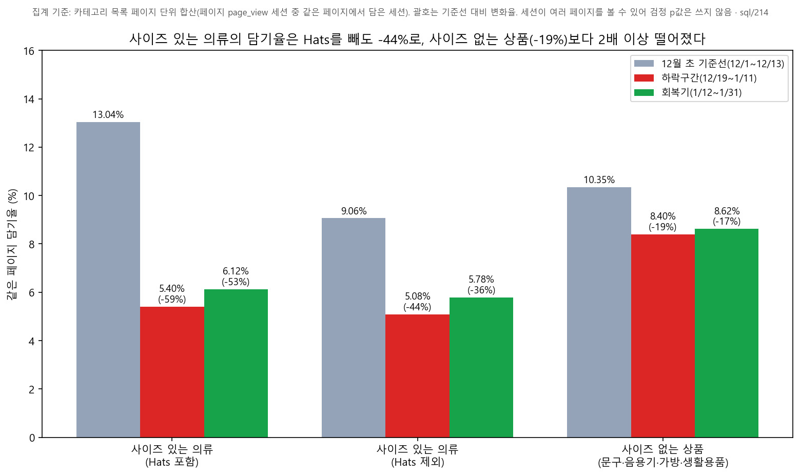
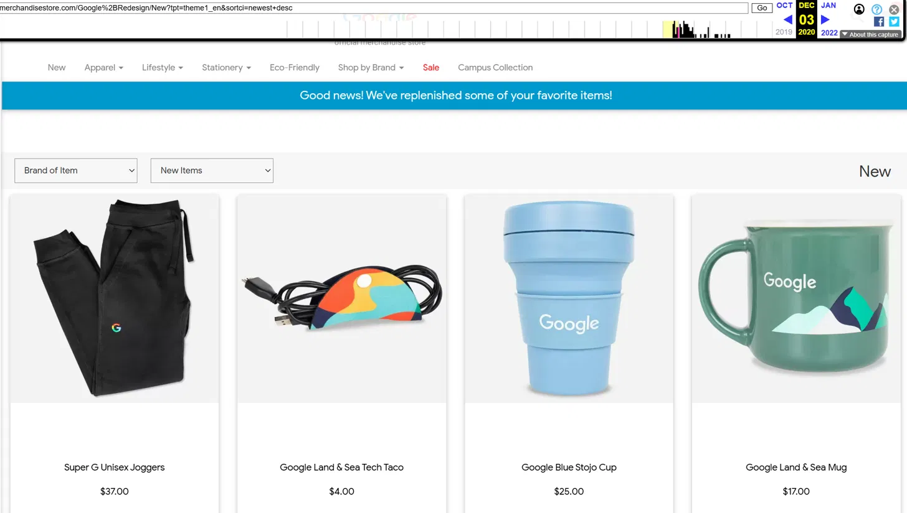
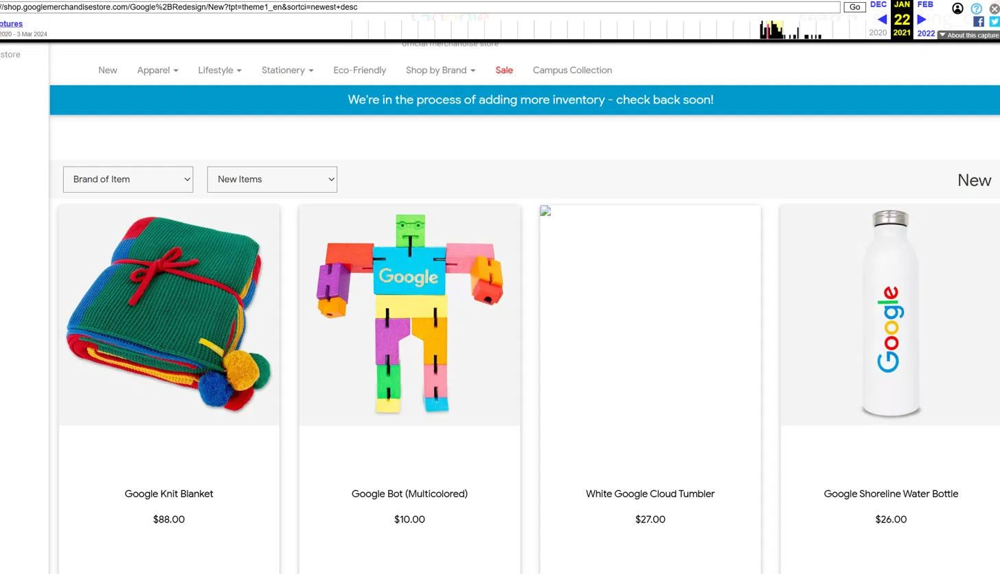
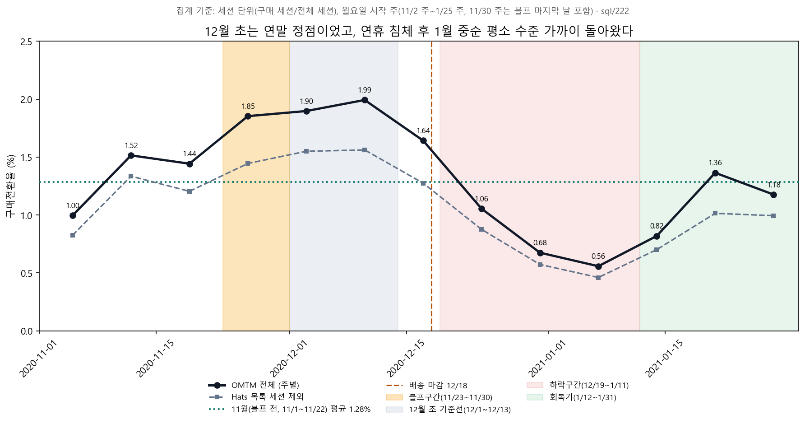
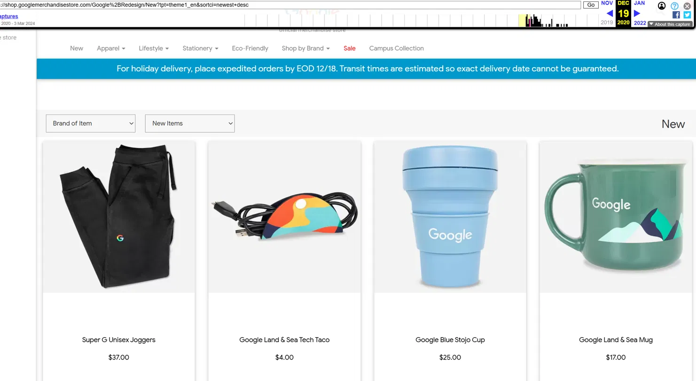
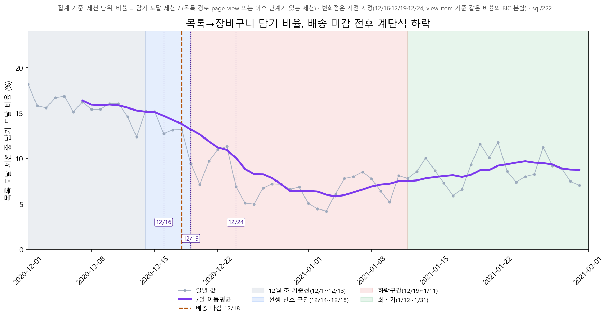
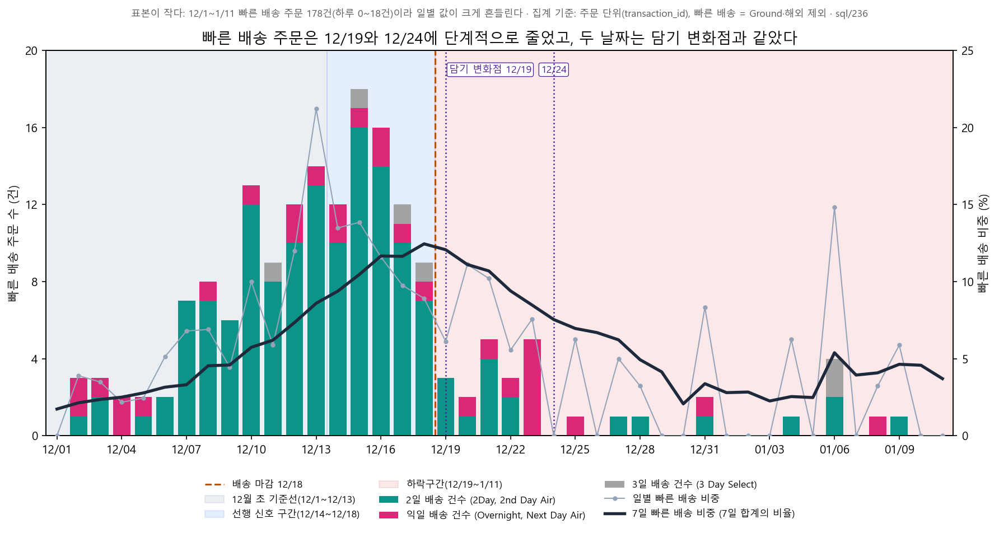

# 10. 원인 분석

| 기호 | 단계 | 비고 |
|---|---|---|
| ① | 방문→목록 노출 / 목록 도달 | 기록 방식에 따라 view_item 기준과 page_view 기준이 다름. view_item 기준은 '목록 노출', page_view 기준은 '목록 도달'로 표기. 각 절에 어떤 기준인지 표시 |
| ② | 목록 도달→장바구니 담기 | |
| ③ | 장바구니 담기→결제 시작 | |
| ④ | 결제 시작→구매 | |

※ 이 문서의 ①②는 절마다 view_item 기준 또는 page_view 기준을 쓴다. 절 제목 아래 또는 본문·표에 기준을 표시했다.

문제 단계는 `docs/09_problem_redefinition.md`에서 정한 ① + ② 방문→담기다. 이 문서는 그 하락의 원인 가설과 검증 결과를 사실 중심으로 기록한다.

## 원인 가설과 예측

| 가설 | 내용 | 맞다면 데이터에서 보여야 할 패턴 |
|---|---|---|
| **H1a** 기준선 이상치 | 12월 초(12/1~12/13)가 일시적으로 높았다(선물 시즌 정점) | 12월 초만 높고 이후 정상 수준으로 돌아온다. 선물성 카테고리(그외형)에서 ②가 더 크게 떨어진다. 11월과 비교해 12월 초가 높다 |
| **H1b** 마감 후 구매 유예 | 12/18 배송 마감 이후 구매를 미뤘다 | 마감 전후로 ②가 떨어진다. 목록을 보고 그 세션에 담지 않은 사용자가 7일 안에 다시 와서 담는 비율이 변한다. 선물성 카테고리에서 더 크다 |
| **H2** 공급 감소 | 담을 만한 상품이 줄었다(품절, 노출 상품 수 감소) | 품절 추정 상품의 노출 비중이 늘거나 목록당 노출 상품 수가 줄어든 카테고리에서 ② 하락이 더 크다. 시점이 품절 시점과 일치한다 |
| **H3** 노출 구성 변화 | 목록에 보이는 상품이 바뀌었다(가격, 세일, 신상품) | 노출 상품의 평균 가격, 세일·신상품 비중 변화가 큰 카테고리에서 ② 하락이 더 크다 |
| **H4a** 화면·기능 변화 | 특정 시점에 화면이나 기능이 바뀌었다 | 특정 날짜에 계단식 단절이 생기고, 기기·브라우저와 무관하게 같은 날 같이 떨어진다. 이벤트 기록 비율은 그대로인데 행동만 바뀐다 |
| **H4b** 측정 변화 | 이벤트 기록 방식이 바뀌어서 하락처럼 보인다 | 다른 기록(page_view, quantity>0)으로 다시 계산하면 하락이 사라지거나 크게 달라진다. page_view 대비 view_item·add_to_cart 이벤트 비율이 하락 시점에 계단식으로 바뀐다. 구매 세션의 앞 단계 기록 보유율이 떨어진다 |

---

## 검증

### H4b 측정 변화: 기각

view_item 기록이 Dino Game Tee 페이지에서 1월 말 갑자기 늘었고(`docs/09` 4절), add_to_cart의 quantity>0 비율도 12월 초에 떨어져서 기록 방식이 시기별로 바뀐 정황이 있어 먼저 확인했다. (쿼리: `sql/211_h4b_session_funnel_alt_definitions.sql`, `sql/212_h4b_daily_event_ratios.sql`, `sql/213_h4b_purchase_sessions_prior_stage_records.sql`)

**1. ①을 page_view로 다시 계산** (목록 경로의 page_view가 있는 세션 또는 이후 단계가 있는 세션)

| 지표 | 기준선 | 하락 (지수) | 회복기 (지수) | 일별 변화점 |
|---|---|---|---|---|
| ① view_item 기준 (기존) | 18.72% | 12.87% (69) | 14.66% (78) | 12/6, 12/24, 1/19 |
| ① page_view 기준 | 53.24% | 56.51% (106) | 53.74% (101) | 12/18, 1/5, 1/8 (하락 없음) |
| ② view_item 기준 (기존) | 44.81% | 32.24% (72) | 32.43% (72) | 12/16, 12/19, 12/24 |
| ② page_view 기준 | 15.75% | 7.34% (47) | 8.85% (56) | 12/19, 12/24, 1/11 |
| ① + ② 방문→담기 | 8.39% | 4.15% (49) | 4.75% (57) | 12/19 시작, 1/6 바닥 |

page_view 기준으로는 목록 도달(①)이 줄지 않았고, 하락 전체가 목록 이후 담기(②)로 이동한다. ① + ②는 ①의 정의와 무관하게 같다.

**2. ②를 quantity>0 담기로 다시 계산**

| 지표 | 기준선 | 하락 (지수) | 회복기 (지수) | 변화점 |
|---|---|---|---|---|
| ② 기존 | 44.81% | 32.24% (72) | 32.43% (72) | 12/16, 12/19, 12/24 |
| ② q>0 담기 (이후 단계 포함) | 42.33% | 27.04% (64) | 28.12% (66) | 12/16, 12/24, 1/13 |
| ② q>0 담기만 | 36.71% | 22.25% (61) | 22.23% (61) | 12/7, 12/16, 12/24 |
| ① + ② q>0 담기 (이후 단계 포함) | 7.92% | 3.48% (44) | 4.12% (52) | — |
| ① + ② q>0 담기만 | 6.87% | 2.86% (42) | 3.26% (47) | — |

quantity=0인 add_to_cart만 있는 세션도 같은 세션에서 결제시작까지 간다.

| 구간 | q>0 담기 세션: 결제시작 / 구매 | q=0 담기만 있는 세션: 결제시작 / 구매 |
|---|---|---|
| 기준선 | 46.3% / 19.3% (4,484세션) | 28.7% / 16.7% (425세션) |
| 하락 | 30.2% / 15.5% (2,360세션) | 22.6% / 12.2% (712세션) |
| 회복기 | 39.4% / 22.0% (2,528세션) | 29.6% / 15.9% (696세션) |

q=0 담기 세션의 결제시작 도달률은 q>0 세션의 62~75%다. q=0 담기만 있는 세션의 비중은 11/30 주 3.8% → 12/7 주 12.6% → 12/14 주 20.6%로 올라 21~24%에 머문다.

**3. 기록 방식 변화 직접 확인** (일별·주별 이벤트 수 비율)

| 주 | 11/30 | 12/7 | 12/14 | 12/21 | 12/28 | 1/4 | 1/11 | 1/18 | 1/25 |
|---|---|---|---|---|---|---|---|---|---|
| view_item / page_view | 33.0% | 32.5% | 33.2% | 30.4% | 19.7% | 18.0% | 19.5% | 24.2% | 21.7% |
| add_to_cart / page_view | 7.0% | 7.3% | 8.7% | 7.8% | 4.4% | 3.6% | 4.1% | 3.9% | 3.3% |
| add_to_cart 중 quantity>0 비율 | 88.8% | 63.5% | 52.4% | 48.1% | 45.8% | 50.1% | 50.5% | 51.4% | 57.0% |

일별로 가장 큰 계단(3일 전후 평균 변화)은 다음과 같다.
- quantity>0 비율: **12/8 83% → 12/9 57%** (−32%p)
- view_item / page_view: **12/28 26.8% → 12/29 19.6%** (−8.3%p), 1/19에 16.1% → 23.0%로 다시 상승
- add_to_cart / page_view: 12/19 (−2.6%p), 12/30 (−2.2%p). 12/19는 토요일이고 page_view가 12/18 16,028 → 12/19 10,728로 33% 줄어든 날이다.
- ② 변화점(12/16, 12/19, 12/24) 중 12/16과 12/24에는 이 비율들이 뚜렷이 바뀌지 않았다.

구매 세션 중 같은 세션에 앞 단계 기록이 있는 비율은 구간별로 안정적이다.

| 구간 | 구매 세션 | 같은 세션 담기 | 목록 view_item | 목록 page_view |
|---|---|---|---|---|
| 기준선 | 1,237 | 75.8% | 92.2% | 97.5% |
| 전환 | 492 | 73.2% | 92.1% | 96.3% |
| 하락 | 616 | 73.5% | 94.5% | 97.9% |
| 회복기 | 886 | 75.4% | 93.3% | 97.2% |

**4. 방문→담기(① + ②)는 대체 기록으로 계산해도 같은 하락**: 기준선 대비 지수가 하락구간 42~49, 회복기 47~57이다. OMTM(구매 세션 / 전체 세션, −60.5%)은 구매 이벤트와 세션 수로 계산하므로 view_item·add_to_cart 기록 방식과 무관하다.

**판정: 기각.** 기록 방식 변화로는 방문→담기 하락이 설명되지 않는다.
- 대체 기록(page_view, quantity>0)으로 계산해도 하락이 사라지지 않는다(지수 42~49).
- quantity>0 기준으로 세면 하락이 더 깊게 나오는데, quantity>0 기록 비율이 12/9에 떨어졌기 때문이다.
- 기록 방식 변화 신호는 있지만(quantity>0 12/9, view_item / page_view 12/29와 1/19) ② 변화점(12/16, 12/24)과 맞지 않는다.
- 구매 세션의 앞 단계 기록 보유율이 구간별로 변하지 않았다.

다만 **①과 ②의 분리는 기록 방식에 민감하다**(page_view 기준 ① 지수 106/101, ② 47/56). 그래서 `docs/09`에서 핵심 문제 단계를 ① + ②로 묶었고, page_view 기준으로 보면 하락의 위치는 ②다.

### H1b 마감 후 구매 유예: 기각

목록을 보고 그 세션에는 담지 않은 사용자가 7일 안에 다시 와서 담은 비율을 기간별로 비교했다. 코호트는 기간 안에서 사용자의 첫 "목록 경로 page_view가 있고 add_to_cart는 없는 세션"이고, 결과는 그 세션 시작 이후 7일 이내 다른 세션에서 담았는가다. 회복기는 7일 추적이 가능한 1/24까지의 세션만 썼다. (쿼리: `sql/216_h1b_defer_return_cart_7d.sql`)

| 구간 | 코호트 사용자 | 7일 안 재방문 | **7일 안 재방문 후 담기** | 재방문한 사용자 중 담은 비율 |
|---|---|---|---|---|
| 기준선 12/1~12/13 | 26,303 | 19.8% | **2.31%** | 11.7% |
| 하락 12/19~1/11 | 39,423 | 12.9% | **0.86%** | 6.6% |
| 회복기 1/12~1/24 | 22,583 | 15.9% | **1.51%** | 9.4% |
| (Hats 목록 세션 제외) 기준선 / 하락 / 회복기 | 25,192 / 38,338 / 21,751 | 19.0% / 12.4% / 15.1% | 2.20% / 0.79% / 1.42% | — |

미룬 뒤 7일 안에 다시 와서 담는 비율이 하락구간에 오히려 줄었고(2.31% → 0.86%), 재방문 자체도 줄었다(19.8% → 12.9%). Hats 목록 세션을 빼도 같다. **판정: 기각.**

차트: `reports/charts_ver2/cause_h1b_return_cart.png`

### H2 공급 감소: 1차 결과 (최종 판정 전)

**품절 추정 방법**: 구매 이벤트의 상품 코드(숫자)와 목록 노출 이벤트의 상품 코드(GGOE…)가 달라서 상품명(소문자)으로 연결했다. 마지막 구매일까지 28일 동안 구매가 10개 이상이었고 마지막 구매가 1/17 이전인 상품을 "품절 추정"으로 보고, 마지막 구매일 + 7일부터 품절로 간주했다(37개 상품, 노출 데이터와 이름이 매칭된 것은 36개. Google Leather Strap Hat Blue·Black 포함). 노출 데이터는 목록 경로의 view_item 중 아이템이 6개 이상인 이벤트다. (쿼리: `sql/219`~`221`)

| 지표 | 기준선 | 하락 | 회복기 |
|---|---|---|---|
| 품절 추정 상품 노출 비중 | 0.64% | **5.33%** | 2.78% |
| 품절 추정 상품 노출 비중 (Hats 제외) | 0.20% | 4.98% | 2.63% |
| 목록당 노출 상품 수 | 11.40 | 11.43 | 11.22 |

**카테고리 25개의 ② 하락폭과의 상관** (Spearman ρ, 괄호는 p값. ②는 page_view 기준 같은 페이지 장바구니 담기 비율, `sql/214`)

| 지표의 변화 | 하락 (Hats 포함, n=25) | 하락 (Hats 제외, n=24) | 회복기 (Hats 포함) | 회복기 (Hats 제외) |
|---|---|---|---|---|
| 품절 추정 비중 | +0.05 (0.81) | +0.14 (0.51) | +0.37 (0.07) | +0.34 (0.10) |
| 목록당 노출 상품 수 | −0.28 (0.17) | −0.32 (0.13) | +0.23 (0.26) | +0.13 (0.55) |

품절 추정 비중이 늘었지만 카테고리별 ② 하락폭과는 상관이 없고, 방향도 예측(비중이 늘수록 ②가 더 떨어짐, 음의 상관)과 반대이거나 0에 가깝다. 목록당 노출 상품 수는 거의 변하지 않았다.

**단, Hats 목록은 품절 추정 비중이 늘면서 ②가 크게 떨어졌다.** Hats 페이지의 ②는 −32.4%p(42.7% → 10.3%, 하락구간 기준), 품절 추정 비중은 +10.7%p였다. 이 카테고리 한 곳이 ② 하락의 약 38%를 차지한다(아래 "Hats 효과"). 품절 추정 비중이 크게 늘어난 다른 카테고리(Socks +30.3%p)에서는 ② 하락이 −3.6%p였다.

**1차 판정**: 카테고리 전반에서는 공급 감소(품절 추정 비중, 노출 상품 수)와 ② 하락의 상관이 없다. Hats는 품절과 함께 크게 하락했다. 최종 판정은 추가 확인 후 기록한다.

### H2 공급 감소 (2차): 상품 전체 품절 기준, 판정 보류

카테고리 단위 상관에서는 인기 상품 한두 개의 품절 효과가 평균에 묻힐 수 있어서 상품 단위로 다시 확인했다. 상품 단위 담기는 quantity>0 기록으로만 알 수 있고 그 비율이 시기별로 바뀌므로, 절대 건수 대신 "quantity>0 담기 중 점유율"로 비교했다. Hats 상품(Hats 목록에서 담기의 50% 이상이 일어난 상품 12개)은 제외했다. (쿼리: `sql/223_cart_qpos_item_events.sql`)

- **이후 품절 상품의 기준선 점유율**: 기준선 quantity>0 담기(Hats 제외) 11,829건 중 이후 품절 추정된 상품 34개의 점유율은 **8.54%**다. 상위는 Google Clear Pen 4-Pack 1.35%, Google Decal 0.79%, YouTube Jotter Task Pad 0.63%, YouTube Crew Socks 0.55%다. 담기 세션(3,387개) 중 이 상품이 포함된 세션은 20.25%, 이 상품만 담은 세션은 4.58%다.
- **그 담기가 하락구간에 완전히 사라졌다고 가정했을 때 ②**: 실제 ②(Hats 목록 세션 제외, page_view 기준)는 11.78% → 6.56%(−5.21%p, 상대 −44.3%)다.

| 가정 | ② 변화 | 실제 하락의 몇 % |
|---|---|---|
| 점유율 8.54%만큼 담기가 사라짐 (중앙 추정) | 11.78% → 10.77% (−1.01%p) | **19%** |
| 이 상품만 담은 세션(4.58%)이 사라짐 | −0.54%p | 10% |
| 이 상품이 포함된 세션(20.25%) 전부 사라짐 (상한) | −2.39%p | **46%** |

- **품절 추정 시작 이후에도 담기는 계속됐다.** 시작 이후 일평균 담기는 기준선의 22%로, 같은 기간 전체 quantity>0 담기가 일평균 25%로 줄어든 것과 비슷한 수준이다. 이 상품들의 담기 점유율은 기준선 8.54% → 하락구간 10.72%(품절 시작 이후의 담기만 6.30%) → 회복기 4.91%다. 그래서 위 가정은 상한 쪽이다.
- **대체 구매 패턴은 없다.** 품절 상품이 있던 목록 페이지에서 그 외 상품의 담기 점유율은 합산 89.4% → 86.5%로 오히려 줄었고, 페이지별로는 엇갈렸다(Clearance +5.5%p, Stationery/Writing +5.7%p, 스토어 메인 −4.8%p, Stationery −5.5%p).

**2차 결과**: 상품 전체 품절은 ② 하락의 주원인이 아니다. 사이즈 일부 품절은 추가 확인 후 판정한다. **판정 보류.**

### H2 보완: 사이즈 품절과 품절 직접 확인 (판정 보류)

기존 품절 추정은 "구매가 0건이 된 상품"이라, 사이즈 일부만 품절된 상품은 잡지 못한다. 상품 상세 화면에서 Google Eco Tee Black은 XS(146), SM(22)만 재고가 있고 MD~3XL은 "Available Soon"이었다. (사용자 확인, 아래 증거 이미지)

웹 아카이브 캡처일 기준이며, 게시 시작 시점은 알 수 없음 (캡처일 미확인)

**사이즈 정보**: `items.item_variant`는 구매(96.0%)·결제시작(97.3%) 이벤트에는 채워져 있고, 담기(4.9%)·노출(0.5%) 이벤트에는 거의 비어 있다. 값은 XS, SM, MD, LG, XL, 2XL, 3XL이다. 결제시작 이벤트는 수량이 부풀어(회복기 7,442 → 25,161개) 쓰지 않고, 구매 이벤트로 사이즈 분포를 봤다. (쿼리: `sql/224`, `sql/225`)

| 사이즈 있는 의류 구매 수량 분포 | 기준선 | 하락 | 회복기 |
|---|---|---|---|
| XS | 9.6% | 9.3% | 9.1% |
| SM | 19.2% | 16.5% | 17.3% |
| MD | 22.7% | 27.6% | 29.1% |
| LG | 21.0% | 21.7% | 22.2% |
| XL | 19.2% | 16.4% | 15.9% |
| 2XL | 6.2% | 5.5% | 4.3% |
| 3XL | 2.2% | 3.0% | 2.2% |
| 작은 사이즈(XS+SM) | 28.8% | 25.8% | 26.4% |
| 큰 사이즈(LG~3XL) | 48.5% | 46.5% | 44.5% |
| 합계(수량) | 1,341 | 623 | 681 |

**의류 구매 사이즈는 작은 사이즈로 쏠리지 않았다.** 주별 작은 사이즈 비중도 20.6~33.1%로 추세가 없다. 기준선 담기(quantity>0) 상위 의류(Super G Unisex Joggers, Google Zip Hoodie F/C, Google Crewneck Sweatshirt Navy, Google Badge Heavyweight Pullover Black)도 사이즈 쏠림이 없었다.

**Google Eco Tee Black은 사이즈 품절이 확인된다.** 구매 이벤트에는 상품명이 "Google Unisex Eco Tee Black"으로 기록되어 있어 이름을 연결해서 봤다.

| | 기준선 | 하락 | 회복기 |
|---|---|---|---|
| quantity>0 담기 (일평균) | **483** (37.2) | 128 (5.3) | 140 (7.0) |
| 구매 수량 | **10 (전부 XS)** | 5 (XS 4, MD 1) | 32 (XS~3XL 전 사이즈) |
| 노출 1,000건당 담기 | 195.9 | 27.3 | 33.2 |
| 전체 상품 평균 대비 배수 | 9.2배 | 2.1배 | 3.0배 |

주별 구매는 11/2 주 31 → 11/9 주 48 → 11/30 주 7 → 12/14 주 4 → 12/28 주 1 → 1/11 주 0으로 줄었다가 1/18 주 22, 1/25 주 10으로 돌아왔다. 기준선에 담기가 483건(담기 점유율 3.5%)인데 구매는 XS 10개뿐이었다. 이 상품은 구매가 0건이 되지는 않아서 기존 "구매 0건" 기준이 놓친 사례다.

**카테고리 비교: 사이즈 있는 의류 vs 사이즈 없는 상품** (page_view 기준 같은 페이지 장바구니 담기 비율, 페이지 단위 합산. 사이즈 있는 의류 = Apparel, Men's, Women's, Kids, Hats, Socks 등 목록. 사이즈 없는 상품 = 문구, 음용기, 가방, 생활용품 등 목록. 스토어 메인, New, Clearance, Eco-Friendly, Campus, Shop by Brand는 섞여 있어 제외. 쿼리: `sql/214`)

| 구분 | 기준선 | 하락 | 회복기 |
|---|---|---|---|
| 사이즈 있는 의류 (Hats 포함) | 13.04% | 5.40% (**−59%**) | 6.12% (−53%) |
| 사이즈 있는 의류 (Hats 제외) | 9.06% | 5.08% (**−44%**) | 5.78% (−36%) |
| 사이즈 없는 상품 | 10.35% | 8.40% (**−19%**) | 8.62% (−17%) |
| 혼합 페이지 | 7.39% | 5.89% (−20%) | 5.73% (−22%) |

사이즈 있는 의류의 ② 하락은 Hats를 빼도 −44%로, 사이즈 없는 상품(−19%)의 2배 이상이다. 세션이 여러 페이지를 볼 수 있어 페이지 단위 합산이 독립이 아니므로 검정 p값은 과대하게 작을 수 있어서 하락폭 중심으로 기록한다.

차트: `reports/charts_ver2/cause_sized_vs_nonsized.png`

**품절 직접 확인 사례 — Google Leather Strap Hat Black**: 웹 아카이브 11/28 캡처에서 이 상품은 "Out of Stock"이었다. 데이터에서도 이 상품의 구매는 11/23 주 4건이 마지막이고 11/30 주부터 0건이다. 구매 패턴에 기반한 품절 추정(마지막 구매 11/24 + 7일 = 12/1부터 품절)과 일치하는 검증 사례다.

웹 아카이브 캡처일 기준이며, 게시 시작 시점은 알 수 없음

**품절 상태에서도 담기가 가능했다.** 같은 화면에서 상품이 "Out of Stock"인데도 "ADD TO CART" 버튼이 활성화되어 있었다. 그래서 품절 상품에 담기는 계속 쌓이는데 구매는 거의 없는 현상이 생겼다(Hats 목록 세션의 ② 58.4% vs 그 외 11.8%, 기준선 Hats 세션의 결제시작→구매 27.6%, Eco Tee Black 담기 483건 vs 구매 10개). 이것이 **기준선의 장바구니 담기 비율을 부풀린 직접적인 이유**다.

**재고 배너**: 웹 아카이브 12/3 캡처의 상단 배너는 "Good news! We've replenished some of your favorite items!", 1/22 캡처는 "We're in the process of adding more inventory - check back soon!"이었다. 이 배너들은 재고 보충 시점과 재고 부족 시점을 보여주며, 품절이 데이터로 추정한 것보다 넓었을 가능성을 시사한다.

웹 아카이브 캡처일 기준이며, 게시 시작 시점은 알 수 없음

웹 아카이브 캡처일 기준이며, 게시 시작 시점은 알 수 없음

**H2 판정: 보류.** 재고 데이터가 없어 품절 규모를 정확히 측정할 수 없었다. 추정 가능한 범위에서는 Hats, Eco Tee Black 등 일부 상품에 한정됐고, 이 상품들은 품절 상태에서도 담기가 가능해 기준선을 부풀렸다. 사이즈 부분 품절은 대부분 잡히지 않았을 수 있고, 배너(12/3 재입고, 1/22 재고 추가 중)는 품절이 추정보다 넓었을 가능성을 보여준다. 다만 사이즈 없는 상품도 19% 하락했고, 하락 시점이 품절이 아닌 배송 마감·크리스마스와 맞으며, 재고 부족 배너가 걸린 1월 말에도 구매전환율이 회복된 점은 품절이 주원인이 아니라는 정황이다.

### H3 노출 구성 변화: 기각

※ 기준: 노출 상품 구성은 view_item 기준(sql/219), 카테고리별 ②는 page_view 기준(sql/214)

목록 경로에 노출된 상품(view_item 아이템 6개 이상)의 평균 가격, 세일 상품 비중, 신상품 비중을 기간별로 비교했다. 세일 상품은 그 상품의 최빈 가격보다 10% 이상 낮은 가격으로 노출된 경우, 신상품은 11/22 이후 처음 나타난 상품이 최초 노출 후 28일 이내인 경우로 정의했다. (쿼리: `sql/219`~`221`)

| 지표 | 기준선 | 하락 | 회복기 |
|---|---|---|---|
| 노출 상품 평균 가격 | $27.12 | $25.77 | $27.16 |
| 평균 가격 (Hats 제외) | $27.68 | $26.00 | $27.42 |
| 세일 상품 비중 | 1.72% | 2.01% | 2.13% |
| 세일 상품 비중 (Hats 제외) | 1.81% | 2.06% | 2.17% |
| 신상품 비중 | 0.01% | 1.87% | 5.50% |
| 신상품 비중 (Hats 제외) | 0.01% | 1.91% | 5.57% |

**카테고리 25개의 ② 하락폭과의 상관** (Spearman ρ, 괄호는 p값)

| 지표의 변화 | 하락 (Hats 포함) | 하락 (Hats 제외) | 회복기 (Hats 포함) | 회복기 (Hats 제외) |
|---|---|---|---|---|
| 평균 가격 | 0.00 (0.99) | +0.10 (0.65) | +0.16 (0.46) | +0.10 (0.64) |
| 세일 비중 | −0.01 (0.98) | −0.06 (0.77) | −0.11 (0.59) | −0.19 (0.38) |
| 신상품 비중 | 0.00 (0.99) | −0.07 (0.75) | −0.23 (0.27) | −0.23 (0.28) |

가격, 세일, 신상품 비중의 변화는 카테고리별 ② 하락폭과 상관이 없다(|ρ| ≤ 0.23, p ≥ 0.27). **판정: 기각.**

### view_item 기록 변화 시점(12/29, 1/19)에 따른 흔들림

H2, H3의 노출 상품 목록은 view_item 기록에 기반하므로, view_item / page_view 비율이 계단식으로 바뀐 12/29와 1/19를 경계로 하위기간을 나눠 확인했다(Hats 포함).

| 지표 | P0 12/1~12/13 | P1 12/14~12/18 | P2 12/19~12/28 | P3 12/29~1/11 | P4 1/12~1/18 | P5 1/19~1/31 |
|---|---|---|---|---|---|---|
| 노출 수(상품 단위) | 596,755 | 261,748 | 226,284 | 240,507 | 145,151 | 339,547 |
| **품절 추정 비중** | 0.64% | 1.18% | 3.99% | **6.59%** | 5.56% | **1.58%** |
| 평균 가격 | $27.12 | $27.66 | $25.82 | $25.73 | $27.08 | $27.20 |
| 세일 비중 | 1.72% | 2.22% | 2.15% | 1.89% | 1.94% | 2.21% |
| 신상품 비중 | 0.01% | 0.36% | 1.28% | 2.42% | 6.47% | 5.08% |
| 목록당 노출 상품 수 | 11.40 | 11.49 | 11.51 | 11.35 | 11.38 | 11.16 |

평균 가격과 목록당 노출 상품 수는 경계(12/29, 1/19)에서 안정적이다. 품절 추정 비중은 두 경계에서 크게 달라진다(P2 → P3 3.99% → 6.59%, P4 → P5 5.56% → 1.58%). 이 값들은 view_item 기록 변화에 따라 흔들렸을 수 있다.

### Hats 효과

기준선의 Hats 목록 장바구니 담기 비율이 품절 모자의 담기 열풍으로 부풀려져 있었는지 확인했다. Hats 목록 세션은 Hats 목록 페이지의 page_view가 있는 세션이다(기준선 2,963세션 4.5%, 하락 1,737세션 2.1%, 회복기 2,098세션 2.7%). (쿼리: `sql/214`, `sql/215`)

**Hats 세션과 그 외 세션의 단계 비율**

| 구간 | 세션 | ② (page_view 기준) | ③ 담기→결제시작 | ④ 결제시작→구매 |
|---|---|---|---|---|
| 기준선 Hats | 2,963 | 58.4% | 60.9% | **27.6%** |
| 기준선 그 외 | 62,288 | 11.8% | 45.6% | 55.4% |
| 하락 Hats | 1,737 | 27.5% | 43.2% | **57.8%** |
| 하락 그 외 | 80,647 | 6.6% | 34.5% | 49.0% |
| 회복기 Hats | 2,098 | 32.4% | 50.7% | 55.5% |
| 회복기 그 외 | 75,476 | 7.6% | 44.0% | 52.5% |

**Hats 목록 세션을 뺐을 때** (page_view 기준 ①)

| 지표 | 전체: 기준선 → 하락 (지수) → 회복기 (지수) | Hats 제외 |
|---|---|---|
| OMTM | 1.90% → 0.75% (39) → 1.14% (60) | 1.52% → 0.62% (41) → 0.92% (61) |
| ① 방문→목록 도달 | 53.24% → 56.51% (106) → 53.74% (101) | 51.02% → 55.58% (109) → 52.46% (103) |
| ② 목록 도달→담기 | 15.75% → 7.34% (47) → 8.85% (56) | 11.78% → 6.56% (56) → 7.60% (65) |
| ① + ② 방문→담기 | 8.39% → 4.15% (49) → 4.75% (57) | 6.01% → 3.65% (61) → 3.99% (66) |
| ③ 담기→결제시작 | 50.47% → 35.68% (71) → 45.20% (90) | 45.62% → 34.47% (76) → 43.97% (96) |
| ④ 결제시작→구매 | 44.79% → 50.49% (**113**) → 53.15% (119) | 55.42% → 49.01% (**88**) → 52.53% (95) |

- Hats를 빼면 ② 하락은 줄지만(지수 47 → 56, 56 → 65) 사라지지 않는다.
- **전체 기준 결제시작→구매 상승(지수 113, 119)은 Hats 세션 때문이다.** 기준선 Hats 세션의 ④는 27.6%로 매우 낮았다가(결제시작 1,055세션 중 구매 291) 하락구간에 57.8%로 올랐다. Hats를 빼면 ④는 하락구간 지수 88, 회복기 95로 오히려 하락한다.

**Hats 제외 하락 기여도** (로그 분해, 합 100%)

| 비교 | OMTM 변화 | ① + ② 방문→담기 | ③ 담기→결제시작 | ④ 결제시작→구매 |
|---|---|---|---|---|
| 기준선 → 하락, 전체 | −60.6% | 76% | 37% | −13% |
| 기준선 → 하락, **Hats 제외** | −59.4% | **55%** | **31%** | **+14%** |
| 기준선 → 회복기, 전체 | −39.8% | 112% | 22% | −34% |
| 기준선 → 회복기, **Hats 제외** | −39.4% | **82%** | 7% | +11% |

Hats를 빼도 하락 기여는 방문→담기(55%)가 가장 크다. ④는 전체에서는 −13%(하락을 줄이는 쪽)였지만 Hats를 빼면 +14%(하락을 키우는 쪽)다.

**카테고리별 ② 하락 분해** (페이지 단위 합산 ②, page_view 기준 같은 페이지 장바구니 담기 비율. 세션이 여러 페이지를 볼 수 있어 세션 단위 값과 다르다)

| 비교 | ② 변화 | 구성(세션 비중) 변화 | 카테고리별 장바구니 담기 변화 | **Hats 몫** |
|---|---|---|---|---|
| 기준선 → 하락 | 9.79% → 6.18% (−3.61%p) | −1.23%p | −2.39%p | **총 변화의 38%** (구성 −0.41%p, 비율 −0.96%p) |
| 기준선 → 회복기 | 9.79% → 6.44% (−3.35%p) | −0.68%p | −2.67%p | 총 변화의 40% (구성 −0.29%p, 비율 −1.04%p) |

Hats 페이지의 ②는 42.7%(기준선) → 10.3%(하락) → 10.1%(회복기)다. Hats를 뺀 합산 ②는 기준선 8.51% → 하락 6.09%(−2.42%p), 회복기 6.34%(−2.17%p)다. 나머지 62%는 Men's(−0.36%p), 스토어 메인(−0.31%p), Drinkware(−0.19%p) 등 여러 카테고리에 퍼져 있다.

### H1a 기준선 이상치: 부분 지지

12월 초(기준선)가 일시적으로 높았는지 보려고 11월과 비교했다. OMTM(구매 세션 / 전체 세션)은 구매 이벤트와 세션 수만 쓰므로 담기·결제시작 기록이 불완전했던 11월에도 영향이 없어서 11월을 포함해 계산했다. (쿼리: `sql/222_h1a_daily_omtm_hats_split_from_nov.sql`)

**주별 OMTM** (월요일 시작 주. 10/26 주는 11/1 하루, 11/30 주는 11/30~12/6이라 블프 마지막 날을 포함한다. Hats 제외 = Hats 목록 page_view가 있는 세션 제외)

| 주 | 10/26 | 11/2 | 11/9 | 11/16 | 11/23 | 11/30 | 12/7 | 12/14 | 12/21 | 12/28 | 1/4 | 1/11 | 1/18 | 1/25 |
|---|---|---|---|---|---|---|---|---|---|---|---|---|---|---|
| 세션 | 2,625 | 24,991 | 22,508 | 25,914 | 27,780 | 31,088 | 38,729 | 33,411 | 22,083 | 20,444 | 29,029 | 27,707 | 27,478 | 26,342 |
| OMTM 전체 | 0.50% | 1.00% | 1.52% | 1.44% | 1.85% | 1.90% | 1.99% | 1.64% | 1.06% | 0.68% | 0.56% | 0.82% | 1.36% | 1.18% |
| OMTM Hats 제외 | 0.48% | 0.83% | 1.34% | 1.20% | 1.45% | 1.55% | 1.56% | 1.28% | 0.88% | 0.57% | 0.46% | 0.70% | 1.01% | 0.99% |
| Hats 세션 비중 | 5.3% | 5.0% | 5.5% | 5.2% | 5.1% | 5.0% | 4.3% | 3.3% | 2.3% | 1.9% | 2.1% | 2.2% | 3.2% | 2.6% |
| Hats 세션 OMTM | 0.7% | 4.2% | 4.6% | 5.8% | 9.5% | 8.5% | 11.6% | 12.3% | 8.5% | 6.0% | 5.2% | 6.0% | 12.1% | 7.9% |
| ① page_view 기준 | 47.7% | 44.3% | 50.6% | 51.7% | 56.1% | 55.4% | 51.6% | 55.9% | 60.3% | 59.3% | 51.0% | 53.6% | 53.0% | 54.8% |

**구간별 OMTM 비교**

| 구간 | 세션 | 구매 세션 | OMTM | Hats 제외 OMTM | 기준선 대비 | 회복기 대비 |
|---|---|---|---|---|---|---|
| 11/1~11/22 (블프 전) | 76,038 | 977 | **1.285%** | 1.093% | 68% (Hats 제외 72%) | 112% (Hats 제외 119%) |
| ㄴ 11/1~11/8 | 27,616 | 262 | 0.949% | 0.793% | 50% | 83% |
| ㄴ 11/9~11/22 | 48,422 | 715 | 1.477% | 1.265% | 78% | 129% |
| 블프 11/23~11/30 | 32,363 | 641 | 1.981% | 1.541% | 105% | 173% |
| **기준선 12/1~12/13** | 65,234 | 1,236 | **1.895%** | 1.518% | 100% | 166% |
| 하락 12/19~1/11 | 82,384 | 616 | 0.748% | 0.616% | 39% | 66% |
| **회복기 1/12~1/31** | 77,574 | 886 | **1.142%** | 0.921% | 60% | 100% |

- 11월(블프 전) 평균 OMTM은 기준선과 회복기 사이에서 **회복기 쪽에 가깝다**: 기준선의 68%, 회복기의 112%이고, 회복기(0)와 기준선(100) 사이의 19% 지점이다(Hats 제외 29%). 11/9~11/22만 보면 44% 지점이다. 블프 구간(1.981%)은 기준선(1.895%)과 같은 수준이다.
- 하락구간 OMTM을 11월(블프 전) 평균과 비교하면 −41.8%(기준선 대비는 −60.5%)이고, 11/9~11/22와 비교하면 −49%다.
- Hats 세션 비중은 11월 5.0~5.5%, 12월 이후 1.9~4.3%이고, Hats 세션의 OMTM은 11월 4.2~5.8%에서 블프 이후 8.5~12.3%로 올랐다.

**page_view 신뢰도** (11월 포함, 주별)

| 지표 | 11월 (11/2~11/30 주) | 12월~1월 |
|---|---|---|
| page_view가 하나라도 있는 세션 비중 | 90.2~91.9% | 92.6~95.4% |
| 세션당 page_view 수 | 4.06~4.30 | 2.82~3.89 |
| page_location이 비어 있는 page_view | 0% | 0% |
| 구매 세션 중 목록 경로 page_view가 있는 비중 | 96.2~99.2% | 95.6~98.8% |

page_view는 11월에도 위치 정보가 모두 기록되어 있고, 구매 세션의 목록 page_view 기록 비율이 12월~1월과 같은 수준이다. ① page_view 기준은 11/1~11/22 48.8%(기준선 53.2%의 92%)로, 첫 주(11/2 주 44.3%)가 낮고 11/9 주부터 50.6~56.1%다.

(② 목록 도달→담기와 ① + ②는 add_to_cart 기록이 필요한데 11월은 담기 기록이 불완전해서 이 비교에 쓰지 않았다.)

**판정: 부분 지지.**
- 11월(블프 전) OMTM 1.285%는 기준선(1.895%)보다 회복기(1.142%)에 가깝다.
- 11월 기준으로는 하락구간 OMTM 하락이 −41.8%로, 기준선 대비 −60.5% 중 약 1/3(18.7%p)은 기준선이 연말 정점이었기 때문이다. 나머지는 평소보다도 낮아진 연휴 기간 하락이다.
- 회복기 OMTM(1.142%)은 11월 평소 수준(1.285%)의 약 89%까지 돌아왔다.
- **한계**: 방문→담기(① + ②)는 11월 담기 기록이 불완전해서 평소 수준과 비교할 수 없다. 이 판정은 OMTM(구매 세션 / 전체 세션)만으로 한 것이다.

차트: `reports/charts_ver2/cause_omtm_weekly_nov_jan.png`

### H4a 화면·기능 변화: 기각

웹 아카이브(Wayback Machine) 스냅샷에서 화면 구조, 담기 버튼, 상품 카드에 변화가 없었다. (사용자가 직접 확인)

확인한 상단 배너(스냅샷 날짜 기준):

| 스냅샷 날짜 | 배너 문구 |
|---|---|
| 12/3 | "Good news! We've replenished some of your favorite items!" |
| 12/19 | "For holiday delivery, place expedited orders by EOD 12/18..." |
| 1/22 | "We're in the process of adding more inventory - check back soon!" |

- 날짜는 크롤러가 페이지를 캡처한 시점이고, **배너 게시가 시작된 시점은 알 수 없다.**
- 스냅샷 간격이 띄엄띄엄이라 **짧은 기간의 화면 변화는 확인할 수 없다.**

**판정: 기각.** 확인된 스냅샷에서 화면 구조·담기 버튼·상품 카드가 바뀌지 않았다.

**하락 전후 목록 화면 비교** (New 목록 페이지, 웹 아카이브): 12/3(하락 전), 12/19(하락 시작), 1/22(하락 후).
- 화면 구성(상단 메뉴, 배너 영역, 필터 드롭다운, 상품 카드의 사진·이름·가격 배치)이 세 시점에서 같다.
- 12/3과 12/19는 첫 4개 상품도 같다(Super G Unisex Joggers, Google Land & Sea Tech Taco, Google Blue Stojo Cup, Google Land & Sea Mug). 1/22는 New 정렬 상품이 바뀌었다(Google Knit Blanket, Google Bot (Multicolored), White Google Cloud Tumbler, Google Shoreline Water Bottle).
- 달라진 것은 상단 배너 문구뿐이다.

웹 아카이브 캡처일 기준이며, 게시 시작 시점은 알 수 없음

웹 아카이브 캡처일 기준이며, 게시 시작 시점은 알 수 없음

웹 아카이브 캡처일 기준이며, 게시 시작 시점은 알 수 없음

---

## 담기→결제시작 단계와의 연결

(작성 전)

## 결론

### 판정

※ 기준: ② page_view 기준(H2, H3)

| 가설 | 판정 | 핵심 근거 |
|---|---|---|
| H1a 기준선 이상치 | **부분 지지** | 11월(블프 전) OMTM 1.285%는 기준선(1.895%)보다 회복기(1.142%)에 가깝다. 기준선 대비 −60.5% 중 약 1/3은 기준선이 연말 정점이었기 때문이다 |
| H1b 마감 후 구매 유예 | **기각** | 미룬 뒤 7일 안에 다시 와서 담는 비율이 줄었고(2.31% → 0.86%) 재방문도 줄었다(19.8% → 12.9%) |
| H2 공급 감소 | **보류** (일부 상품 영향, 주원인이 아닐 정황) | 품절 추정 비중은 늘었지만 카테고리별 ② 하락과 상관이 없고, Hats·Eco Tee Black 등 일부 상품에 한정됐다. 사이즈 없는 상품도 19% 하락했다 |
| H3 노출 구성 변화 | **기각** | 가격·세일·신상품 비중 변화와 카테고리별 ② 하락의 상관이 없다 |
| H4a 화면·기능 변화 | **기각** | 웹 아카이브에서 화면 구조, 담기 버튼, 상품 카드에 변화가 없었다 |
| H4b 측정 변화 | **기각** | 대체 기록(page_view, quantity>0)으로 계산해도 방문→담기 하락이 같다 |

### 남는 설명

**연말 선물 시즌 정점 이후 배송 마감(12/18)과 연휴를 지나며 목록 방문은 유지됐으나 담기 의도가 줄었다. 특히 선물 성격이 강한 의류에서 크게 줄었다.**

웹 아카이브 캡처일 기준이며, 게시 시작 시점은 알 수 없음

### 근거

※ 기준: ② page_view 기준, 단 근거 1의 변화점 12/16·12/19·12/24는 view_item 기준(page_view 기준 변화점은 12/19·12/24·1/11)

1. **하락 시점과 배송 마감의 일치.** ② 변화점이 12/16, 12/19, 12/24이고(view_item 기준 일별 ②의 BIC 분할, 12/18 배송 마감 전후), page_view 기준 ②에서도 12/19, 12/24에 계단이 있다(1/11에 한 번 더 있다). 12/19 웹 아카이브 캡처의 배너가 "For holiday delivery, place expedited orders by EOD 12/18..."이다. 다만 배너 게시 시작 시점은 알 수 없다.

차트: `reports/charts_ver2/cause_stage2_daily_steps.png`

2. **page_view 기준 목록 도달이 유지됐다.** ① 지수 106(하락구간), 101(회복기). 목록에는 계속 왔고, 목록 이후 담기(②)가 떨어졌다(지수 47, 56).
3. **모든 기기·브라우저에서 같은 시기에 하락했다.** page_view 기준 ② 변화점이 desktop·mobile 12/19와 12/24, Chrome 12/18과 12/24, Safari 12/16과 12/24다. view_item 기준으로는 desktop 12/16, 12/24, mobile 12/20, Chrome 12/16, 12/19, Safari 12/20이다. 이후 1월 중의 변화점은 기기·브라우저마다 다르다(page_view 기준 1/5~1/19). (쿼리: `sql/226`)
4. **미룬 뒤 돌아와 담는 비율이 줄었다.** 7일 안 재방문 후 담기 2.31% → 0.86%(회복기 1.51%).

차트: `reports/charts_ver2/cause_h1b_return_cart.png`

5. **사이즈 있는 의류의 하락폭이 더 크다.** Hats를 빼도 −44%로, 사이즈 없는 상품(−19%)의 2배 이상이다.
6. **1월 중순 이후 구매전환율이 11월 평소 수준의 약 89%로 회복됐다.** 회복기 OMTM 1.142% vs 11월(블프 전) 1.285%.

차트: `reports/charts_ver2/cause_omtm_weekly_nov_jan.png`

7. **배송 등급 정황 (입증이 아니라 정황).** 구매의 배송 등급 중 빠른 배송 비중이 12월에 올랐다가 12/19와 12/24에 단계적으로 줄었다. 마감 직전에 몰리지는 않았다. 자세한 내용은 아래 "배송 등급 정황"에 있다.

8. **기프트카드 관심도 정황 (입증이 아니라 정황).** 배송 마감 이후 기프트카드 페이지를 방문하는 비율이 줄었다(목록 방문 사용자 대비 기준선 0.25% → 선행 0.18% → 하락구간 0.07% → 회복기 0.09%, `sql/242`). 배송 장벽만이 아니라 선물 의도 자체가 줄었다는 정황이다. 기간별 기프트카드 페이지 방문 사용자가 23~75명이고 주문도 0~5건이라 숫자가 작아 방향만 확인할 수 있다.

차트: `reports/charts_ver2/cause_expedited_shipping_daily.png`

### 배송 등급 정황 (결론 근거 7)

입증이 아니라 정황이다. 배송 마감과 연말 선물 시즌이 사용자의 구매 행동에 영향을 줬다면 빠른 배송을 고르는 구매가 선행 신호 구간(12/14~12/18)에 오르고 12/19 이후 내려가야 한다고 결과를 보기 전에 예측을 정하고 확인했다.

**데이터.** 구매 이벤트의 `shipping_tier`(배송 업체와 서비스 등급)를 썼다. 11/23 주부터 구매의 99% 이상에 값이 있어(11/23 이후 주문 3,860건 중 값 없음 33건) 그 이후만 사용했다. 11/16 주 이전에는 78~100%가 비어 있다. 주문은 `transaction_id` 기준 단위로 세었고(purchase 이벤트 5,692건이 4,475개 주문), 날짜는 구매 이벤트의 날짜다. 빠른 배송은 Ground와 해외 배송을 뺀 것(2Day, 2nd Day Air, 3 Day Select, Overnight, Next Day Air)이고, 비중은 값이 있는 국내 주문(Ground + 빠른 배송) 중 빠른 배송의 비율이다. (쿼리: `sql/236`)

**기간별 빠른 배송 비중**

| 기간 | 주문 | 빠른 배송 | 비중 (95% CI) | 하루 평균 빠른 배송 |
|---|---|---|---|---|
| 11월 말 11/23~11/30 | 667 | 11 | 1.7% (0.9~3.0) | 1.4건 |
| 기준선 12/1~12/13 | 1,299 | 81 | **6.4% (5.1~7.8)** | 6.2건 |
| &nbsp;&nbsp;(12/1~12/7) | 580 | 19 | 3.3% (2.1~5.1) | 2.7건 |
| &nbsp;&nbsp;(12/8~12/13) | 719 | 62 | 8.9% (7.0~11.2) | 10.3건 |
| 선행 신호 12/14~12/18 | 590 | 67 | **11.5% (9.2~14.4)** | 13.4건 |
| 하락 12/19~1/11 | 637 | 30 | **4.8% (3.4~6.8)** | 1.2건 |
| &nbsp;&nbsp;(12/19~12/23) | 242 | 18 | 7.6% (4.9~11.7) | 3.6건 |
| &nbsp;&nbsp;(12/24~1/11) | 395 | 12 | 3.1% (1.8~5.4) | 0.6건 |
| 회복기 1/12~1/31 | 667 | 14 | **2.1% (1.3~3.6)** | 0.7건 |

- 선행 구간(11.5%)은 기준선 전체(6.4%)보다 높고(p<0.001), 하락구간(4.8%)은 선행 구간보다 낮다(p<0.001). 하락구간은 기준선과 차이가 없고(p=0.21), 회복기(2.1%)는 기준선보다 낮다(p<0.001). 검정은 빠른 배송과 Ground의 주문 수를 비교한 Fisher 정확검정이다.

**관찰 1.** 비중은 평소(11월 말 1.7%, 회복기 2.1%)에는 낮았고 12월 초부터 올라(12/1~12/7 3.3%, 12/8~12/13 8.9%) 12/13에 일별 최고(21.2%)를 찍었다. 12/19 이후 낮아져 12/19~12/23은 7.6%, 12/24 이후에는 하루 평균 0.6건(3.1%)으로 크게 줄었다. 기준선(12/1~12/13) 6.4%도 평소보다 높았다. 12월이 선물 도착 시점을 의식한 특별한 시기였다는 H1a(기준선이 연말 정점)와 방향이 같다.

**관찰 2.** 속도별로 보면 2일 배송은 12/19 이후 크게 줄었다(선행 구간 5일 57건, 비중 9.8% → 12/19~12/23 10건, 4.2%). 익일 배송(Overnight, Next Day Air)은 12/19~12/23에 8건(비중 3.4%, 12/23에 5건)으로 유지됐다가 12/24 이후 19일간 3건(0.8%)으로 줄었다. 줄어든 날짜가 목록→담기 변화점(12/19, 12/24)과 같다. 해석(확인되지 않음): 크리스마스 전에 도착할 수 있는 배송 수단이 단계적으로 줄어든 시점과 맞을 수 있다. 배송업체별 마감 일정은 확인하지 못했다.

**예측 대비.** 방향은 예측과 같다. 선행 구간은 기준선보다 높고 12/19 이후는 선행 구간보다 낮다. 다만 두 가지가 예측과 다르다.
- **상승은 12/14 이전부터 서서히 시작됐고 마감 직전에 몰리지 않았다.** 12/8~12/13이 이미 8.9%이고 선행 구간(11.5%)과 차이가 크지 않으며(p=0.135), 선행 구간 안에서도 12/15(13.8%)부터 12/18(8.9%)까지 내려갔다.
- **12/19 이후 바로 사라지지 않고 단계적으로 줄었다.** 12/19~12/23에도 18건(7.6%)이 있었고, 12/24 이후에야 하루 0.6건으로 줄었다.

**한계**
- 빠른 배송 주문이 적어(11/1~1/31 전체 205건, 차트 구간 12/1~1/11은 178건에 하루 0~18건) 일별 값이 크게 흔들린다.
- 마감 효과와 12월 초부터 이어진 추세를 구분할 수 없다.
- 속도별 패턴의 이유는 확인되지 않은 해석이다.

### 결론의 한계

- **다른 가설을 배제하고 남은 설명이다.** 이 설명을 직접 검증한 것은 아니다.
- **한 시즌 데이터라 계절 패턴으로 확정할 수 없다.**
- **의류의 선물 효과와 사이즈 품절 효과를 분리할 수 없다.**
- **품절 규모를 정확히 측정하지 못했다.** 재고 데이터가 없다.
- **방문→담기(① + ②)는 11월 담기 기록 문제로 평소 수준과 비교할 수 없다.**

## 한계

※ 기준: ② page_view 기준(H2, H3의 카테고리별 상관)

- H4b 점검은 view_item·add_to_cart의 기록 변화를 중심으로 확인했다. 구매 이벤트와 세션 수는 기록 방식과 무관하다고 보았지만, page_view 자체가 시기별로 다르게 기록됐을 가능성은 확인하지 못했다.
- quantity>0 비율이 12/9에 떨어진 원인과 view_item이 12/29, 1/19에 계단식으로 바뀐 원인은 확인하지 못했다.
- 구매 세션의 앞 단계 기록 보유율은 구매한 세션에 대한 것이라, 구매하지 않은 세션의 기록 누락은 이 방법으로 확인되지 않는다.
- **품절 추정은 상품명 연결과 구매 패턴에 기반한 추정이고 실제 재고 데이터가 아니다.** 구매가 사라진 이유가 품절인지 수요 감소인지는 구분되지 않는다. 구매 이벤트와 노출 이벤트의 상품 코드가 달라서 상품명으로 연결했고, 이름이 다르게 기록된 상품은 놓쳤을 수 있다. 또한 view_item 기록 변화 시점(12/29, 1/19)에 품절 추정 비중이 크게 흔들린다.
- H1b는 7일 안 재방문만 확인했다. 7일을 넘겨 연말연시 이후에 담는 지연은 이 지표로 보이지 않는다. 회복기 코호트는 1/24까지만 사용했다.
- H2, H3의 카테고리별 상관은 카테고리 25개(Hats 제외 24개)로 계산해서 표본이 작고, Hats는 ② 하락폭이 다른 카테고리보다 훨씬 커서 단일 사례가 상관에 크게 영향을 준다.
- H3의 세일 상품은 가격이 최빈 가격보다 10% 이상 낮은 노출, 신상품은 11/22 이후 처음 나타난 상품의 28일 이내 노출로 정의한 근사치이고, 노출 비중이 매우 작다(세일 1.7~2.1%).

---

## 증거 자료

`reports/evidence/`의 웹 아카이브(Wayback Machine) 캡처다. 모두 캡처일 기준이며 게시 시작 시점은 알 수 없다.

| 파일명 | 캡처일 | 증명하는 내용 |
|---|---|---|
| `2020-11-28_leather-strap-hat-black_out-of-stock.png` | 2020-11-28 | Google Leather Strap Hat Black이 "Out of Stock"인데 "ADD TO CART" 버튼이 활성화되어 있음. 블랙프라이데이 배너("...BLACKFRIDAY10 for 10% off your next order until 11/30!") |
| `list-card-add-to-cart_mens.png` | 캡처일 미확인 | 목록 카드에서 상품을 누르면 "Add to Cart"와 "View Product" 버튼이 나옴(상세 페이지 없이 담기 가능) |
| `eco-tee-black_size-table.png` | 캡처일 미확인 | Eco Tee Black 상세 화면의 사이즈별 재고: XS 146, SM 22, MD~3XL "Available Soon" |
| `2020-12-03_new-banner-replenished.png` | 2020-12-03 | New 목록 화면, 배너 "Good news! We've replenished some of your favorite items!" |
| `2020-12-19_new-banner-holiday-delivery.png` | 2020-12-19 | New 목록 화면, 배너 "For holiday delivery, place expedited orders by EOD 12/18. Transit times are estimated so exact delivery date cannot be guaranteed." |
| `2021-01-22_new-banner-adding-inventory.png` | 2021-01-22 | New 목록 화면, 배너 "We're in the process of adding more inventory - check back soon!" |
